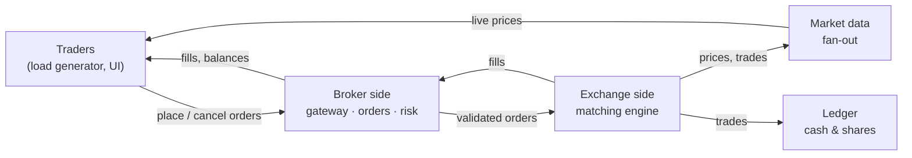

# Mini Exchange

A learning project: build a small **stock exchange** and a **brokerage** on top of it, using Kafka, Redis and Postgres, and hold the result to real **non-functional requirements** (latency, throughput, durability, fault tolerance), measured under load.

The goal is not just a working system. It's to learn three things:

1. **The domain**: how orders, order books, matching, market data and settlement actually work.
2. **The infrastructure**: Kafka, Redis and Postgres from first principles, including how they fail and how to tune them.
3. **The craft**: writing code that stays correct and fast under load, proven with benchmarks, property tests, chaos tests and profiling.

> **Status:** design phase. Nothing is built yet. These docs are under review.

---

## What we're building (one picture)



- The **broker** is the company you hold an account with (think Zerodha or Robinhood). It checks you can afford the order and forwards it.
- The **exchange** (think NSE or NYSE) keeps an **order book** per stock and matches buyers with sellers.
- **Market data** broadcasts live prices to everyone.
- The **ledger** moves cash and shares between accounts after a trade, and must never get the numbers wrong.

Full explanation in [`docs/domain/01-trading-101.md`](docs/domain/01-trading-101.md).

---

## How to read these docs

Read in this order.

| # | Read / Do | Why |
|---|---|---|
| 1 | [Trading 101](docs/domain/01-trading-101.md) + [Glossary](docs/domain/glossary.md) | Understand the business before the tech |
| 2 | Tech primers: [Kafka](docs/tech/kafka.md), [Redis](docs/tech/redis.md), [Postgres](docs/tech/postgres.md), [WebSockets](docs/tech/websockets.md), [Observability](docs/tech/observability.md) | Mental models for each tool, from zero |
| 3 | [Requirements](docs/requirements.md) | What "done" and "good enough" mean, in numbers |
| 4 | [Architecture](docs/architecture.md) | The reference design, component by component |
| 5 | [ADRs](docs/adr/README.md) | Why each major decision was made, and what it costs |
| 6 | [System walkthrough](docs/system-walkthrough.md) | **Everything in one place:** one order from tap to ledger to 10,000 screens, with every save and every state |
| 7 | [Roadmap](docs/roadmap.md) + [Engineering practices](docs/engineering-practices.md) | How we build it, phase by phase |

---

## Tech stack

| Concern | Choice | Primer |
|---|---|---|
| Language & framework | Java 25 + Spring Boot (engine is a plain Java library) | [ADR-0010](docs/adr/0010-java-and-spring-boot.md) |
| Event log / messaging | Apache Kafka (KRaft mode, 3 brokers) | [kafka.md](docs/tech/kafka.md) |
| Hot state, rate limits, fan-out | Redis | [redis.md](docs/tech/redis.md) |
| Financial source of truth | PostgreSQL | [postgres.md](docs/tech/postgres.md) |
| Client streaming | WebSockets | [websockets.md](docs/tech/websockets.md) |
| Metrics / dashboards / traces | Prometheus, Grafana, OpenTelemetry + Jaeger | [observability.md](docs/tech/observability.md) |
| Load balancing, storage, dev tools | HAProxy, MinIO (snapshots), Kafka UI | [ADR-0011](docs/adr/0011-supporting-infrastructure.md) |
| Load & chaos | Custom Java load generator, k6, Toxiproxy | [engineering-practices.md](docs/engineering-practices.md) |
| Local runtime | Docker Compose (Kubernetes in a later phase) | |

---

## Roadmap at a glance

| Phase | Theme | You learn |
|---|---|---|
| 0 | Foundations & labs | Hands-on Redis and Kafka basics, the domain |
| 1 | Matching engine (pure library) | Data structures, allocation-free code, property testing, benchmarking |
| 2 | Engine as a Kafka service | Event sourcing, snapshots, crash recovery, exactly-once |
| 3 | Broker: gateway, orders, risk | Redis Lua, rate limiting, idempotency, concurrency races |
| 4 | Market data fan-out | Pub/sub, WebSockets, backpressure, slow consumers |
| 5 | Ledger & settlement | Postgres transactions, double-entry, idempotent consumers, reconciliation |
| 6 | Hardening | Chaos testing, soak tests, high availability, tuning, capacity report |
| 7 | Build-your-own | A Redis-lite and a Kafka-lite, swapped into the system and compared |

Details, exit criteria and load targets for each phase: [`docs/roadmap.md`](docs/roadmap.md).

---

## Repository layout (planned)

A Maven multi-module build. Each service is a Spring Boot app; the engine is a plain Java library.

```
.
├── README.md
├── docs/                    # domain, tech, requirements, architecture, ADRs, walkthrough
├── pom.xml                  # parent POM: modules, dependency & plugin versions
├── engine/                  # Phase 1: matching engine library (plain Java, no Spring, no I/O)
├── common/                  # money helpers, event schemas (generated from proto/), Kafka/Redis utils
├── proto/                   # protobuf event & API schemas
├── redis/scripts/           # Lua scripts (reserve, release, fill, rate limit)
├── services/
│   ├── gateway/             # Spring Boot: REST + auth + rate limiting + idempotency
│   ├── oms/                 # Spring Boot: order management + pre-trade risk
│   ├── matcher/             # Spring Boot shell around engine + raw Kafka clients
│   ├── marketdata/          # Spring Boot: book builder + Redis publisher
│   ├── wsgateway/           # Spring Boot: WebSocket fan-out to clients
│   ├── ledger/              # Spring Boot: settlement + double-entry ledger
│   └── candles/             # Spring Boot: OHLCV aggregation
├── loadgen/                 # traders, market makers, WS subscribers (plain Java, virtual threads)
├── benchmarks/              # JMH benchmarks
├── chaos/                   # failure-injection scenarios
├── deploy/                  # docker-compose, HAProxy, Prometheus, Grafana dashboards
└── perf-log/                # one file per optimization: baseline → change → result
```

## Not in scope

Real money, real market connectivity, regulation and compliance, multiple asset classes (options, futures), and a polished UI. We keep the domain only as realistic as it needs to be to create **real engineering pressure**.
