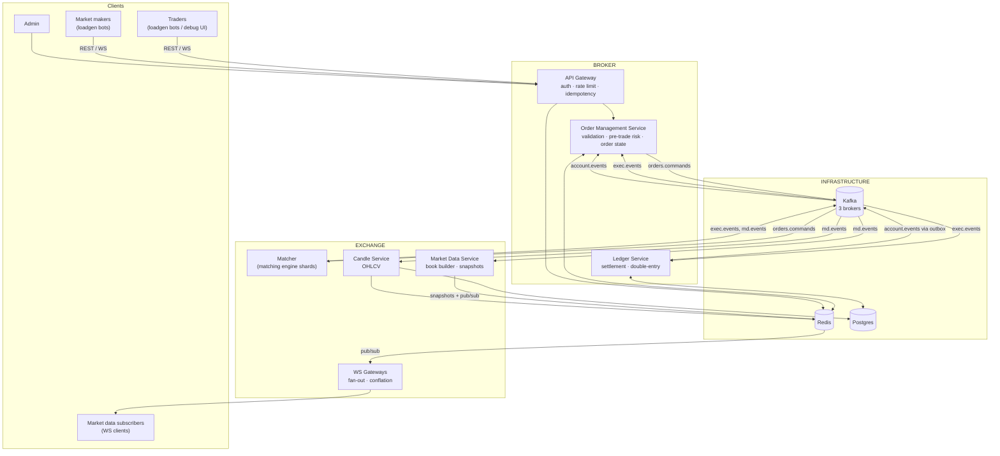
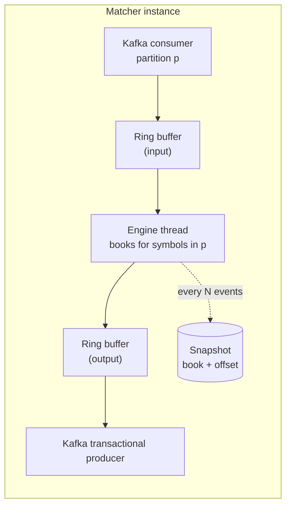
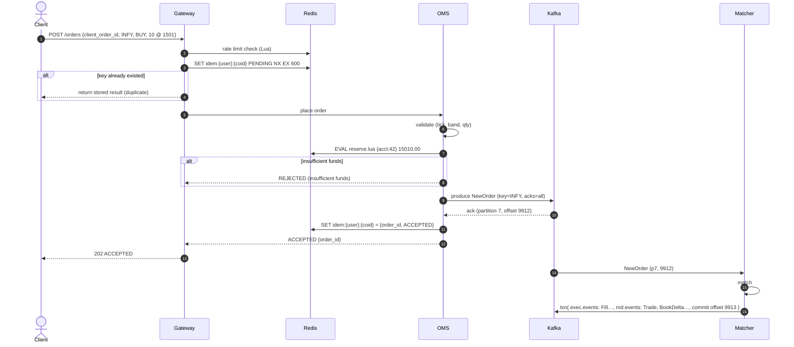
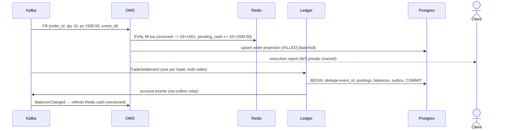
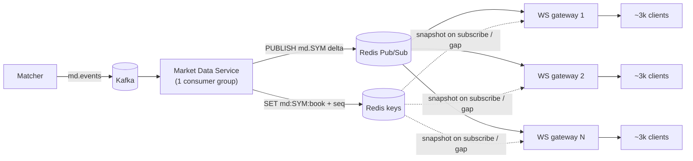
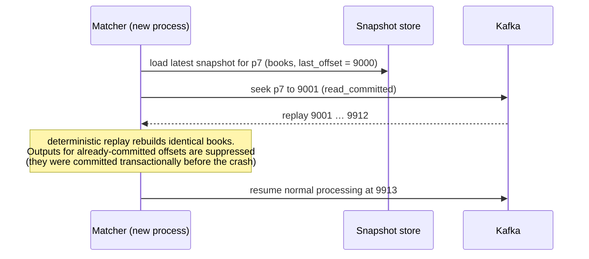
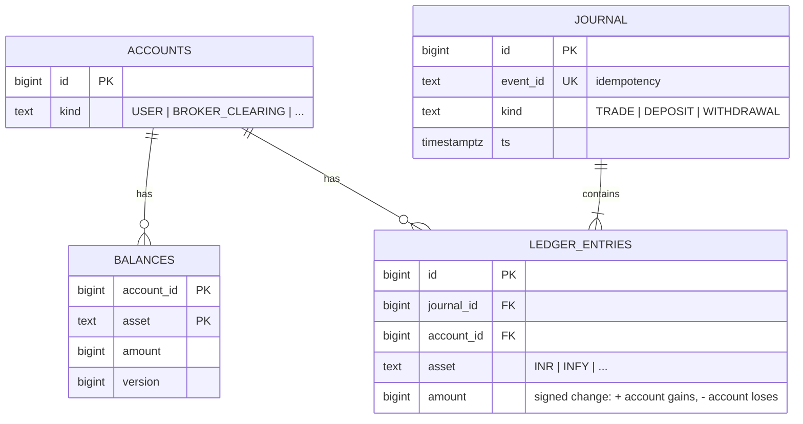
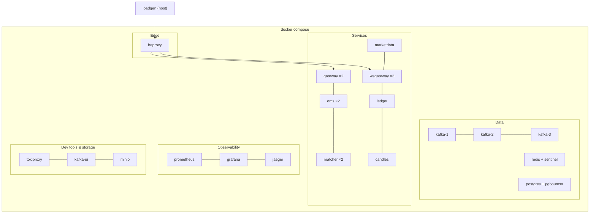
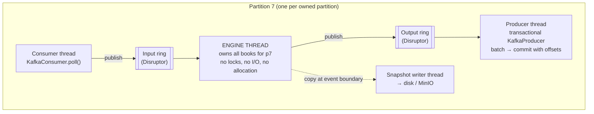

# Architecture

This doc moves from the big picture to the details:
1. [Design principles](#1-design-principles)
2. [System context](#2-system-context)
3. [Components](#3-components)
4. [Key flows](#4-key-flows)
5. [Kafka topics and events](#5-kafka-topics-and-events)
6. [Data model](#6-data-model)
7. [Partitioning & scaling](#7-partitioning--scaling)
8. [Failure modes](#8-failure-modes)
9. [Capacity estimates](#9-capacity-estimates)
10. [Deployment](#10-deployment)
11. [Open questions](#11-open-questions)
12. [Concurrency model](#12-concurrency-model)

---

## 1. Design principles

These six principles drive almost every decision below. When in doubt, come back to them.

1. **The log is the truth.** Order intent lives in Kafka (`orders.commands`). Engine state, order status and market data are all *derived* by replaying logs. ([ADR-0002](adr/0002-event-sourced-core-with-kafka.md))
2. **One writer per order book.** Each symbol's book is mutated by exactly one thread. No locks on the hot path, and determinism comes for free. ([ADR-0003](adr/0003-single-threaded-matching-per-shard.md))
3. **Deterministic core, side effects at the edges.** The engine is a pure function: `(state, input) → (state', outputs)`. No clocks, no randomness, no I/O inside it. This makes replay, testing and hot standby possible.
4. **At-least-once everywhere, idempotent everywhere.** Every consumer dedupes by event ID or sequence number. Exactly-once is achieved, not assumed. ([ADR-0006](adr/0006-exactly-once-processing.md))
5. **Fast state is derived state.** Redis is fast but can lose writes, so it only holds things we can rebuild from Kafka or Postgres. ([ADR-0005](adr/0005-pre-trade-risk-in-redis.md))
6. **Fail closed on money, fail open on information.** If we can't verify funds, reject the order. If market data is degraded, keep trading.

---

## 2. System context



---

## 3. Components

### 3.1 API Gateway (`services/gateway`)
- **Does:** terminates HTTP/REST (and a private WS channel for execution reports), authenticates API keys, enforces **rate limits** (Redis), and checks **idempotency** (`client_order_id`).
- **Stateless.** Scale horizontally.
- **Why separate from OMS?** Edge concerns (auth, rate limiting, protocol) are different from domain logic, and the gateway is where abusive traffic should be stopped cheaply.

### 3.2 Order Management Service: OMS (`services/oms`)
- **Does:**
  1. Validates orders (symbol exists, tick size, qty limits, price band).
  2. Assigns `order_id` (needed first: every reservation is recorded under its order).
  3. Runs **pre-trade risk**: an atomic reserve in Redis via Lua, then produces `NewOrder` to `orders.commands` (key = symbol, `acks=all`).
  4. Returns `PENDING_NEW` / `ACCEPTED` to the client once Kafka acknowledges.
  5. Consumes `exec.events` to update order state (projection in Postgres + cache), release or adjust reservations, and push execution reports to the client.
  6. Consumes `account.events` to keep Redis cash/holdings in sync with the ledger.
- **Stateless request path**; the consumers are scaled by partition.
- Pre-trade risk lives **inside** the OMS rather than in its own service, to avoid a network hop on the hottest path ([ADR-0005](adr/0005-pre-trade-risk-in-redis.md)).

### 3.3 Matcher (`services/matcher` wrapping `engine/`)
- **Does:** consumes `orders.commands`, applies price-time matching, and produces `exec.events` (private) and `md.events` (public) in **one Kafka transaction** together with its input offsets.
- **Sharding:** one engine instance owns a set of partitions. Inside, **one thread per partition** owns all the books for the symbols in that partition.
- **State:** in-memory books. Periodic **snapshots** (book state + last input offset) go to local disk (later MinIO, [ADR-0011](adr/0011-supporting-infrastructure.md)). Recovery = load snapshot + replay from offset ([ADR-0009](adr/0009-snapshots-and-replay-recovery.md)).
- **Deterministic:** no wall-clock reads in matching. Timestamps come from the input message (stamped by the OMS), and IDs are derived from `(partition, offset, seq)`.



The ring buffers decouple network I/O from matching, so the engine thread never blocks on a socket. (This is the LMAX Disruptor pattern. We start with `ArrayBlockingQueue`, then switch to the Disruptor and measure the difference.)

### 3.4 Market Data Service (`services/marketdata`)
- **Does:** consumes `md.events`, maintains the **L2 book** and last-trade state per symbol, writes **snapshots** to Redis (`md:{SYM}:book` with a seq number), and publishes deltas to Redis Pub/Sub channel `md.{SYM}`. The snapshot update and the delta publish happen in **one Lua script**, so the snapshot's `md_seq` and the published deltas never disagree ([ADR-0007](adr/0007-market-data-fanout.md)).
- **Why not have WS gateways read Kafka directly?** See [ADR-0007](adr/0007-market-data-fanout.md). In short: one Kafka consumer instead of N, Redis Pub/Sub is the cheaper fan-out primitive, and it teaches Redis.

### 3.5 WS Gateways (`services/wsgateway`)
- **Does:** holds client WebSocket connections. On subscribe: sends a snapshot from Redis, subscribes to `md.{SYM}` (once per gateway, shared by all its clients), and fans out deltas.
- **Per-client conflation:** each client has a bounded "latest state per symbol" slot. Slow clients get coalesced updates; clients persistently behind are disconnected.
- **Stateless apart from connections.** Scale horizontally behind a load balancer.

### 3.6 Ledger Service (`services/ledger`)
- **Does:** consumes `TradeSettlement` events from `exec.events` (one per trade, both sides; [ADR-0008](adr/0008-double-entry-ledger-in-postgres.md)), writes **double-entry postings** in Postgres in batched transactions, dedupes by `event_id`, and updates `balances`. Writes `account.events` to an **outbox** in the same transaction; a relay publishes them to Kafka.
- **Source of truth** for cash and holdings ([ADR-0008](adr/0008-double-entry-ledger-in-postgres.md)).
- Runs the **reconciliation** job: ledger invariants, plus Redis risk state vs ledger + open orders.

### 3.7 Candle Service (`services/candles`)
- **Does:** consumes trades from `md.events` and aggregates 1s and 1m OHLCV per symbol using **event time** (the trade timestamp, not arrival time). Recent candles go to Redis, closed candles to Postgres.

### 3.8 Load Generator (`loadgen/`)
- Trader bots (Poisson arrivals, configurable symbol skew), market-maker bots (quote around a moving "fair price"), and WS subscriber bots (including a slow-client fraction).
- **Open-loop** scheduling with HdrHistogram latency recording ([observability.md](tech/observability.md#4-coordinated-omission-the-classic-benchmarking-mistake)).

---

## 4. Key flows

### 4.1 Place order (happy path)



### 4.2 Fill propagation



**Subtle point:** between the fill and the ledger settling it, cash appears in two places (reserved in Redis, not yet debited in Postgres). Redis tracks a `pending` amount so buying power stays correct throughout. The [system walkthrough §11](system-walkthrough.md#11-step-8-redis-catches-up-with-the-ledger) traces this window step by step.

### 4.3 Market data fan-out



### 4.4 Cancel order

1. Client → Gateway → OMS: `cancel(order_id)`.
2. OMS looks up the order's symbol (from cache/projection) and produces `CancelOrder` to `orders.commands` with **the same key (symbol)**, so it lands in the same partition **after** the order.
3. Matcher: if the order is resting, it removes it and emits `Cancelled{remaining_qty}`. If it's already filled, it emits `CancelRejected{reason: TOO_LATE}`.
4. OMS releases the reservation for `remaining_qty`.

### 4.5 Matcher crash & recovery



Because outputs and input offsets were committed **in the same transaction**, the committed group offset tells us exactly which outputs exist. Replay from snapshot up to the committed offset is **silent** (state rebuild only), and normal output resumes after it.

---

## 5. Kafka topics and events

| Topic | Key | Partitions | Retention | Producer | Consumers |
|---|---|---|---|---|---|
| `orders.commands` | symbol | 16 | 7 d (size-capped in dev) | OMS | matcher |
| `exec.events` | symbol | 16 | 7 d | matcher | oms, ledger, invariant-checker |
| `md.events` | symbol | 16 | 1 d | matcher | marketdata, candles |
| `account.events` | account_id | 8 | 7 d | ledger (outbox relay) | oms |

All topics: `replication.factor=3`, `min.insync.replicas=2`, producers idempotent with `acks=all`. Encoding: protobuf, with an envelope:

```protobuf
message Envelope {
  string event_id    = 1;  // globally unique, deterministic where possible
  int64  ts_nanos    = 2;  // event time
  string trace_parent = 3; // W3C trace context
  oneof body { NewOrder new_order = 10; CancelOrder cancel = 11; Accepted accepted = 20;
               Rejected rejected = 21; Fill fill = 22; Cancelled cancelled = 23;
               BookDelta book_delta = 30; PublicTrade trade = 31; BalanceChanged balance = 40; }
}
```

Key event shapes (simplified):

| Event | Fields |
|---|---|
| `NewOrder` | order_id, account_id, symbol, side, type, tif, qty, limit_price_ticks, client_order_id, accepted_ts |
| `CancelOrder` | order_id, account_id, symbol |
| `Fill` | order_id, account_id, symbol, side, fill_qty, fill_price_ticks, leaves_qty, trade_id, liquidity (MAKER/TAKER) |
| `TradeSettlement` | trade_id, symbol, qty, price_ticks, buyer_account_id, buyer_order_id, seller_account_id, seller_order_id. One per trade, both sides; the ledger's only input from `exec.events` ([ADR-0008](adr/0008-double-entry-ledger-in-postgres.md)) |
| `Cancelled` | order_id, cancelled_qty, reason |
| `BookDelta` | symbol, md_seq, side, price_ticks, new_level_qty (0 = level removed) |
| `PublicTrade` | symbol, md_seq, trade_id, price_ticks, qty, aggressor_side |

**IDs:** `trade_id` / `event_id` from the matcher = `p{partition}-{input_offset}-{n}`. This is deterministic, so replays regenerate identical IDs and downstream dedupe works.

---

## 6. Data model

### 6.1 Money & prices
All prices are **integer ticks** (₹0.05 = 1 tick) and money is **integer paise** (int64). **Never floats** ([ADR-0004](adr/0004-integer-fixed-point-money.md)).

### 6.2 Redis

| Key | Type | Fields / value |
|---|---|---|
| `{acct:42}` | hash | `cash`, `reserved_cash`, `pending_cash`, `ver`, `h:INFY`, `rh:INFY`, `ph:INFY` (held / reserved / pending-delivery qty per symbol) |
| `res:{acct:42}:{order_id}` | hash | per-order reservation: `amount_paise` or `qty`, `created_ts`. Same hash tag as the account, so one Lua script can update both (ADR-0005) |
| `st:{acct:42}:{trade_id}` | string, TTL 1 h | marker: fill/settlement already applied, so they can arrive in either order (ADR-0005) |
| `idem:{42}:{coid}` | string, TTL 10 min (see §9) | `PENDING` or serialized result |
| `rl:{42}` | zset / string | rate limiter state |
| `md:{INFY}:book` | string | binary L2 top-10 + `md_seq` |
| `md.INFY` | pub/sub channel | deltas |
| `candle:{INFY}:1s` | list | last N closed candles |

### 6.3 Postgres (ledger)



- **Invariant:** for every journal, `SUM(amount) GROUP BY asset = 0`.
- `ledger_entries` is **append-only** (never updated or deleted).
- `balances` is a materialized running total, updated in the same transaction.
- Plus: `orders` / `trades` projections (partitioned by day), `processed_events`, `outbox`.

---

## 7. Partitioning & scaling

| Component | Scales by | Limit |
|---|---|---|
| Gateway, OMS request path | More instances (stateless) | Redis and Kafka throughput |
| Matcher | Partitions of `orders.commands` (16) → up to 16 engine threads | **A single symbol can't be split.** One hot symbol = one thread |
| OMS / ledger consumers | Partitions of `exec.events` | Postgres write throughput for the ledger |
| Market data service | Partitions of `md.events` | |
| WS gateways | More instances | Redis Pub/Sub output bandwidth |
| Redis | Vertical first; Cluster with hash tags later | Single-threaded command execution |
| Postgres | Vertical; batching; read replica | Hot accounts (market makers) → row contention |

### The hot-symbol problem
`hash(symbol) % 16` means one symbol always lands on one partition and one engine thread. If INFY is 50% of the traffic (requirement T3), that thread must handle ~5k orders/s, which is easy for a 1M/s engine. **The real bottlenecks are I/O around it**: one partition's Kafka throughput, its consumer, its producer transaction rate. Phase 2/6 experiments: transaction batching (commit every N ms), and a custom partitioner that gives hot symbols a **dedicated** partition so they don't slow down neighbours that hash to the same partition.

### The hot-account problem
Market-maker accounts trade constantly, so every fill updates the same Redis hash and the same Postgres `balances` row. Mitigations to explore: batch postings per account per transaction, and aggregate within a batch before writing.

---

## 8. Failure modes

| Failure | Impact | Mitigation | Verified by |
|---|---|---|---|
| Kafka broker dies | Leader elections (~seconds of produce retries) | RF=3, min.insync=2, idempotent producers retry | Chaos: kill broker under load → D1 |
| 2 Kafka brokers die | Writes refused (`NotEnoughReplicas`) | OMS rejects new orders (fail closed) | Chaos |
| Matcher crashes mid-batch | Shard paused | Transaction aborted → snapshot + replay; RTO ≤ 10 s | Chaos: `kill -9` loop → D2, D5 |
| OMS crashes after Redis reserve, before Kafka produce | **Leaked reservation**; the client never got an ack | Reservations carry `order_id` + timestamp; sweeper releases those with no matching order in the log after a timeout | Fault-injection test |
| OMS crashes after Kafka ack, before replying to client | Client retries with the same `client_order_id` | Idempotency key holds `PENDING`. Retry waits/polls; OMS resolves it from the order projection | Retry-storm test → D6 |
| Redis primary fails | Rate-limit/idempotency/risk state may lose recent writes | Fail closed during failover; rebuild `{acct}` from ledger balances + open orders | Chaos → D4 |
| Ledger down | Settlement lags; trading continues | Reservations keep buying power correct; lag alert | Chaos |
| Postgres fails | Ledger and history unavailable | Replica promotion (Phase 6); ledger consumer resumes from committed offset | Chaos |
| Market data service down | Prices freeze; trading continues | Clients detect staleness by seq/heartbeat | Chaos |
| WS client slow | Its buffer fills | Conflate → disconnect | Isolation test → R4 |
| Poison message (can't deserialize) | Consumer stuck | Dead-letter topic + alert; engine halts the shard (correctness over availability) | Unit/integration test |
| Clock skew | Wrong candle buckets | Event time comes from a single stamping point (OMS) and the engine's input order | Design |

---

## 9. Capacity estimates

Assumptions: 10k orders/s, 20% later cancelled, ~0.6 trades per order (2 fills each), 200 B/command, 150 B/exec event, ~3 md events per order at 80 B.

| Quantity | Estimate |
|---|---|
| `orders.commands` ingress | (10k orders + 2k cancels) × 200 B = **2.4 MB/s** → 8.6 GB/h → ×3 replicas ≈ 26 GB/h on disk |
| `exec.events` | (10k acks + 12k fills + 2k cancels) ≈ 24k/s × 150 B ≈ **3.6 MB/s** |
| `md.events` | 30k/s × 80 B ≈ **2.4 MB/s** |
| Kafka disk at 7-day retention | ~8.4 MB/s × 3 × 604,800 s ≈ **~15 TB**. ⚠️ Too big for a laptop, so dev retention is **size-capped** (e.g. 5 GB/topic). Good lesson: retention is a cost decision |
| Redis memory | 100k accounts × ~200 B + 50 books × ~2 KB + idempotency keys 10k/s × 24 h × ~100 B ≈ **86 GB**. ⚠️ Idempotency TTL must shrink (e.g. 10 min → ~600 MB) or keys must be compacted |
| WS egress | 10k clients × 5 symbols × ~20 conflated updates/s × 100 B ≈ **100 MB/s** (800 Mbps). ⚠️ Near the limit of local networking, so conflation rate and binary encoding matter |
| Ledger writes | 12k fills/s → 24k postings/s (×2 legs ×2 assets → ~48k rows/s). Batching required |

These numbers already raise three design questions (retention, idempotency TTL, WS bandwidth). That's what capacity estimation is for.

---

## 10. Deployment

**Phase 0–5: Docker Compose on one machine.**



- **HAProxy** load-balances the gateway and WS gateway instances (WebSocket-aware, with connection draining).
- **Toxiproxy** sits between services and Kafka/Redis/Postgres so that chaos tests can inject latency, packet loss and partitions.
- **Kafka UI** shows topics, messages and consumer lag while you learn.
- **MinIO** stores engine snapshots (required once a hot standby exists).

Each Spring Boot service runs with a capped heap (e.g. `-Xmx512m`) to fit on a laptop ([ADR-0010](adr/0010-java-and-spring-boot.md)).

**Phase 6+: Kubernetes (kind/k3d)** for autoscaling, rolling deploys and pod-kill chaos.

---

## 11. Open questions

These are deliberately unresolved. They're good discussion material:

1. Should the engine snapshot synchronously (pause matching) or copy-on-write in the background? Measure the latency impact.
2. Is a Kafka transaction per input batch fast enough for the hot symbol, or do we need a custom sequencer?
3. Should execution reports to clients come straight from the matcher's output (lower latency) or only via the OMS (single source of order state)?
4. Hot standby matcher: follow the same input partition (replica-by-replay) or follow the primary's output? How do we prevent split-brain (two active writers)?
5. When the ledger lags by minutes, is Redis buying power still trustworthy? What bound should trigger rejecting new orders?

---

## 12. Concurrency model

Concurrency shows up at three levels in this system:
1. **Inside one JVM:** threads, virtual threads, queues, `ConcurrentHashMap`, ring buffers.
2. **Across processes:** several OMS instances racing on one account, several ledger consumers racing on one balance row, two matchers trying to own one partition.
3. **Across the pipeline:** ordering through Kafka partitions, and backpressure when a downstream stage is slower than the stage feeding it.

### 12.1 Ownership rules (apply everywhere)

| # | Rule |
|---|---|
| 1 | Every mutable object has **exactly one owning thread**, or is explicitly documented as thread-safe (and tested). |
| 2 | Threads hand work to each other **only through queues** (Disruptor, `BlockingQueue`), never by sharing mutable objects. |
| 3 | `KafkaConsumer` is **not thread-safe**: one consumer per thread. `KafkaProducer` **is** thread-safe and should be shared (it batches across threads). Exception: the matcher uses one transactional producer per partition (fencing). |
| 4 | **Virtual threads for blocking I/O** (HTTP request handling, JDBC, Redis calls). **Platform threads for CPU-bound, latency-critical loops** (engine, consumer poll loops). Virtual threads give no benefit to CPU-bound work and make latency harder to control. |
| 5 | No locks on the engine path. Elsewhere, prefer lock-free structures or confinement; any lock is annotated `@GuardedBy`. |
| 6 | Every thread pool you create is **named, bounded and metered** (queue depth, active threads). No unbounded queues. |
| 7 | Cross-process races are solved by a **single serialization point**, never by in-JVM locks (see 12.3). |

### 12.2 Per service

| Service | Threads | Shared state & protection |
|---|---|---|
| **Gateway** | Tomcat on virtual threads (one per request) | Lettuce Redis connection (thread-safe, multiplexed); rate-limit/idempotency atomicity comes from Redis Lua/`SET NX` |
| **OMS** | Request handling on virtual threads; **one platform thread per assigned partition** for `exec.events` and `account.events` consumers | Shared `KafkaProducer`; order cache in `ConcurrentHashMap`; account atomicity via Redis Lua |
| **Matcher** | Per owned partition: consumer thread → Disruptor → **engine thread** → Disruptor → producer thread; plus one snapshot-writer thread | Books are confined to the engine thread (no locks). Snapshot is copied at an event boundary and handed off |
| **Market data** | One consumer thread per partition; Redis publishes via Lettuce async (pipelined) | L2 books confined to their partition's thread |
| **WS gateway** | One Redis subscriber thread (hands off only); per-symbol fan-out; one writer virtual thread per client ([walkthrough §12](system-walkthrough.md#12-step-9-market-data-reaches-10000-screens)) | Per-client conflation mailbox (latest state per symbol) |
| **Ledger** | One consumer thread per partition; each accumulates a batch and writes it with JDBC on the same thread | HikariCP pool sized to consumers + headroom; Postgres row locks, taken in `account_id` order to avoid deadlocks |
| **Background jobs** (sweeper, reconciliation, outbox relay) | `@Scheduled` | Only one instance active cluster-wide, via **Postgres advisory locks** (`pg_try_advisory_lock`) |
| **Load generator** | Open-loop scheduler + virtual threads per simulated client | One HdrHistogram **per thread**, merged at the end (no contention on recording) |

### 12.3 Cross-process serialization points

| Race | Serialization point |
|---|---|
| Two orders spending the same money | Redis Lua script per account (Redis runs one script at a time) |
| Two settlements updating one balance | Postgres row lock (`UPDATE … SET amount = amount + ?`) |
| Two matchers owning one partition | Kafka group membership + **transactional producer fencing** (epoch bump) |
| Two sweepers releasing the same reservation | Postgres advisory lock (one active instance) + idempotent release script |
| Commands for one symbol arriving concurrently | Kafka partition (key = symbol) → total order |

### 12.4 The matcher's threads



The engine thread is the only one that touches the books. Everything else talks to it through ring buffers, so a slow network call or a GC hiccup in the Kafka client can't stall matching (until a ring fills up, at which point backpressure stops the consumer from polling).
