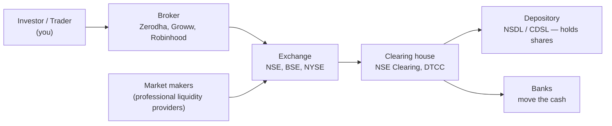
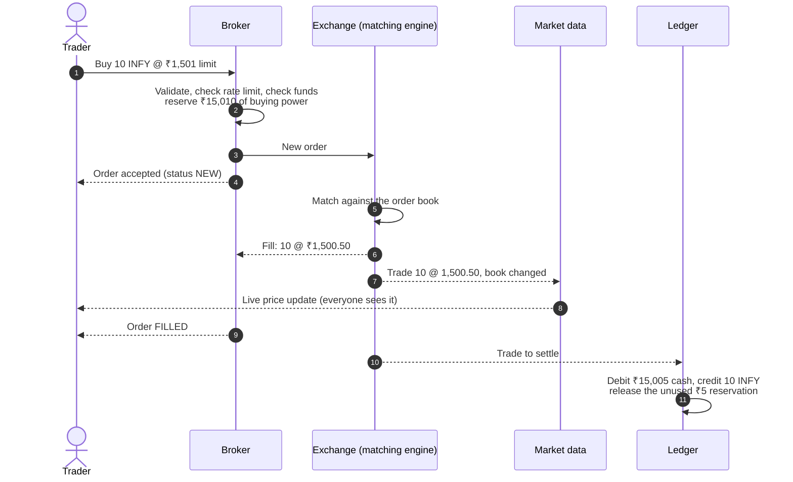
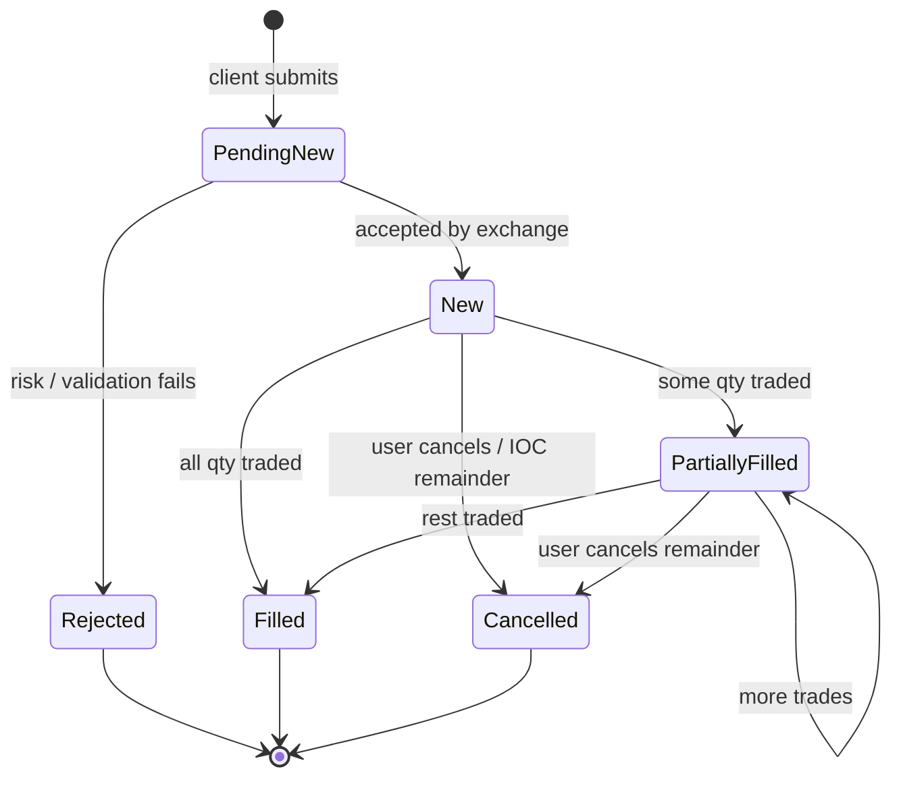

# Trading 101: How a Stock Exchange and a Brokerage Work

This doc assumes you know nothing about trading. By the end you should be able to explain what happens, step by step, when someone taps **"Buy 10 shares of INFY"** in a trading app, and you'll have the vocabulary the rest of the docs use.

Words in **bold** are defined in the [glossary](glossary.md).

---

## 1. The cast



| Actor | What they do | In our project |
|---|---|---|
| **Investor / trader** | Wants to buy or sell shares | Simulated by the load generator (thousands of bots) |
| **Broker** | Holds your account, checks you can afford the trade, sends your order to the exchange | **We build this** (gateway, order service, risk, ledger) |
| **Exchange** | Runs an **order book** per stock and matches buyers with sellers | **We build this** (matching engine, market data) |
| **Market maker** | A firm that always posts both a buy price and a sell price, so there's always someone to trade with. Earns the **spread** | Simulated bots that keep the books full |
| **Clearing house** | After a trade, guarantees both sides get what they're owed, even if one side defaults | Simplified: our ledger settles instantly |
| **Depository** | Holds shares electronically (your "demat" account in India) | Simplified: share balances in our ledger |

**Why have a broker at all?** You can't connect directly to an exchange. Exchanges deal only with licensed members (brokers), who take responsibility for their clients' orders and money. The broker's main job, from an engineering point of view, is **pre-trade risk**: make sure you can pay before your order touches the market.

---

## 2. What is a share, and what is a "price"?

A **share** is a unit of ownership in a company. There is no single official price. The "price" you see in an app is just **the price of the most recent trade** (the **last traded price**, LTP).

Prices come only from people agreeing to trade. The exchange doesn't set prices. It is a meeting place with strict rules about who gets matched with whom.

---

## 3. Orders

An **order** is an instruction: *"I want to buy/sell N shares of X, under these conditions."*

### 3.1 Fields every order has

| Field | Example | Notes |
|---|---|---|
| Symbol | `INFY` | Which stock |
| Side | `BUY` / `SELL` | |
| Quantity | `10` | Number of shares |
| Type | `LIMIT` / `MARKET` | See below |
| Limit price | `₹1,500.00` | Only for limit orders |
| Time in force | `DAY`, `IOC` | How long the order stays alive |
| Client order ID | `c-8f2a…` | Chosen by the client; used to detect duplicates |

### 3.2 Order types we support

**Limit order:** *"Buy 10 INFY at ₹1,500 or less."*
- If someone is selling at ≤ ₹1,500 right now, you trade immediately.
- If not, your order **rests** in the order book, waiting for a seller.
- You never pay more than your limit.

**Market order:** *"Buy 10 INFY at whatever the price is right now."*
- Trades immediately against the best available prices.
- Risky: in a thin market you might pay much more than expected. Real brokers add **price protection** (a hidden limit, for example "no more than 3% above the last price"). We do the same.

**Cancel:** *"Remove my resting order."* It can only cancel what hasn't traded yet.

### 3.3 Time in force

| TIF | Meaning |
|---|---|
| `GTC` / `DAY` | Rests in the book until filled or cancelled (or until the trading day ends) |
| `IOC` (Immediate-Or-Cancel) | Trade whatever you can right now, cancel the rest. Never rests. |

---

## 4. The order book

Each symbol has one **order book**: two sorted lists of resting limit orders.

- **Bids**: buy orders, sorted **highest price first** (the most eager buyer is at the top).
- **Asks** (offers): sell orders, sorted **lowest price first** (the most eager seller is at the top).

```
                ORDER BOOK: INFY
        BIDS (buyers)          ASKS (sellers)
   qty   price                 price   qty
   ----  --------              --------  ----
    50   1,499.50  ← best bid  1,500.50   30  ← best ask
   120   1,499.00              1,501.00   80
   200   1,498.50              1,502.00  150
```

- **Best bid** = ₹1,499.50: the highest price anyone will pay right now.
- **Best ask** = ₹1,500.50: the lowest price anyone will sell at right now.
- **Spread** = 1,500.50 − 1,499.50 = ₹1.00. A tight spread means a liquid, healthy market.
- **Top of book** = best bid + best ask. Most apps show only this.
- **Depth** = the levels below the top.

The book is **not crossed**: best bid < best ask. If a new order would cross (a buy at or above the best ask), it trades immediately instead of resting. That's what matching is.

### 4.1 Price levels and the queue inside each level

Several orders can sit at the same price. Within a price level they form a **FIFO queue**: first in, first served.

```
ASK 1,500.50:  [Order A: 10 @ 09:15:01] → [Order B: 20 @ 09:15:03]   (total 30)
```

---

## 5. Matching: price-time priority

The matching engine follows one rule, used by almost every stock exchange:

> **Best price first. At the same price, earliest order first.**

This is **price-time priority** (FIFO matching).

### 5.1 Worked example

Starting book (asks only, for clarity):

| Ask price | Queue (oldest → newest) |
|---|---|
| 1,500.50 | A: 10, B: 20 |
| 1,501.00 | C: 80 |

**Incoming: BUY LIMIT 40 @ 1,501.00** (order X)

1. Best ask is 1,500.50 ≤ 1,501.00, so it can trade.
   - Match X with **A**: 10 shares @ **1,500.50**. A is fully filled and removed. X has 30 left.
   - Match X with **B**: 20 shares @ **1,500.50**. B is fully filled and removed. X has 10 left.
2. The next best ask is 1,501.00 ≤ 1,501.00, so it can still trade.
   - Match X with **C**: 10 shares @ **1,501.00**. C has 70 left (it **keeps its place** in the queue). X is fully filled.

Result: **3 trades**. X bought 40 shares at an average of (10×1500.50 + 20×1500.50 + 10×1501.00)/40 = ₹1,500.625.

Notice:
- **The trade price is the resting order's price**, not the incoming order's limit. X was willing to pay 1,501 but got 1,500.50 for the first 30. The resting order set the price, and the incoming order "takes" it.
- The resting order is called the **maker** (it made liquidity). The incoming order is the **taker** (it took liquidity). Exchanges often charge takers more.
- A **partial fill** leaves the order alive with its remaining quantity.

**Incoming: BUY LIMIT 50 @ 1,499.80** (order Y)

The best ask is now 1,501.00 > 1,499.80, so nothing matches. Y **rests** on the bid side at 1,499.80 and becomes the new best bid.

### 5.2 The matching algorithm in pseudocode

```
on NewOrder(o):
    book = books[o.symbol]
    opposite = (o.side == BUY) ? book.asks : book.bids
    while o.remaining > 0 and opposite not empty:
        level = opposite.best()
        if o.type == LIMIT and not crosses(o, level.price): break
        while o.remaining > 0 and level not empty:
            resting = level.front()
            qty = min(o.remaining, resting.remaining)
            emit Trade(price=level.price, qty, maker=resting, taker=o)
            o.remaining -= qty; resting.remaining -= qty
            if resting.remaining == 0: level.pop_front()
        if level empty: opposite.remove(level)
    if o.remaining > 0:
        if o.type == LIMIT and o.tif == GTC: book.add(o)      # rest
        else: emit Cancelled(o, reason="unfilled remainder") # IOC / market
```

That's the whole core of an exchange. It looks simple. The engineering challenge is doing this **millions of times per second, never losing an order, never matching anything twice, and recovering exactly after a crash**.

---

## 6. The life of an order (end to end)



### Order states



A key rule: **an order in a final state (Filled, Cancelled, Rejected) can never change again.** If the system ever shows a Filled order receiving another fill, it has a serious bug (a "double fill"). Much of our testing exists to prove this never happens.

---

## 7. Pre-trade risk (the broker's main job)

Before an order goes to the exchange, the broker checks:

| Check | Example |
|---|---|
| **Buying power** | A buy for 10 × ₹1,501 needs ₹15,010 of available cash |
| **Holdings** | A sell of 10 INFY needs 10 INFY that aren't already committed to another sell |
| **Fat-finger limits** | Reject a quantity above 10,000, or a price more than 10% from the last price |
| **Rate limits** | At most N orders per second per user |

**Reservation, not just a check.** If you have ₹20,000 and fire two ₹15,000 buy orders at the same instant, a naive "check then send" lets both through, and you've spent ₹30,000. The broker must atomically **reserve** the money when the order is accepted:

```
available = cash − reserved
on new BUY:   if available ≥ price×qty then reserved += price×qty else REJECT
on fill:      cash −= fill_price×fill_qty;  reserved −= limit_price×fill_qty
on cancel:    reserved −= limit_price×remaining_qty
```

Making this check-and-reserve atomic and fast under heavy concurrency is one of the most important engineering problems in this project. See [ADR-0005](../adr/0005-pre-trade-risk-in-redis.md).

---

## 8. Market data

Every change to the order book is public information. The exchange broadcasts:

| Feed | Content | Who uses it |
|---|---|---|
| **Trades (ticks)** | "10 INFY traded at 1,500.50 at 09:15:03.123" | Charts, last price |
| **L1 / top of book** | Best bid, best ask and their quantities | Most retail apps |
| **L2 / depth** | Total quantity at each price level (top N levels) | Active traders |
| **L3 / full order-by-order** | Every individual order | Professional firms (we won't build this) |
| **Candles (OHLCV)** | Open, High, Low, Close, Volume per 1s/1m/1h interval | Charts |

Market data is the **highest-volume** part of the system: one order can produce several book changes, and every change goes to **every** subscriber. 10,000 subscribers × 5,000 updates/s = 50 million messages/s if you're naive. That's why fan-out design matters (Phase 4).

**Snapshot + delta.** Clients first fetch a **snapshot** (the full current book, with a sequence number) and then apply **deltas** ("level 1,500.50 is now 30"). Every delta has a sequence number. If a client sees seq 101 then 103, it has missed one and must re-fetch the snapshot.

---

## 9. After the trade: clearing & settlement

A trade is a promise: the buyer owes cash and the seller owes shares. **Settlement** is when they actually change hands.

- Real world: India settles on **T+1** (one business day after the trade day), with optional same-day settlement for some stocks. The US moved to T+1 in 2024. A **clearing house** sits in the middle as buyer to every seller and seller to every buyer, so if one side defaults the other is still paid.
- **Our simplification:** we settle **immediately** on each trade, in our own ledger. We keep the engineering core of settlement: a **double-entry ledger** where every movement of money or shares is recorded twice (a debit and a credit), so the books always balance.

### Double-entry in one example

Trader U buys 10 INFY from trader S at ₹1,500.50:

| Account | Debit | Credit |
|---|---|---|
| U: cash | | ₹15,005 |
| S: cash | ₹15,005 | |
| U: INFY shares | 10 | |
| S: INFY shares | | 10 |

Per asset, total debits = total credits, **always**. If a bug creates or destroys even ₹1 or 1 share, a reconciliation job will catch it. See [ADR-0008](../adr/0008-double-entry-ledger-in-postgres.md).

---

## 10. Positions and P&L

- **Position**: how many shares of each symbol you hold (and your average cost).
- **Realized P&L**: profit locked in by selling. Buy 10 @ 100, sell 10 @ 110 → +₹100.
- **Unrealized P&L**: paper profit on what you still hold, using the current market price. Hold 10 bought @ 100, last price 105 → +₹50.

Unrealized P&L changes on every tick for every holder of that symbol, which makes it a good real-time streaming computation (Phase 5).

---

## 11. A trading day

| Phase | What happens | Ours |
|---|---|---|
| Pre-open | Orders collected, an opening price is computed by auction | Skipped |
| Continuous trading | Normal matching (everything above) | **Yes, always open** |
| Circuit breakers | Trading halts if a price moves too far too fast | Optional stretch goal |
| Close | Closing price computed, DAY orders expire | Optional |

---

## 12. What we simplify, and why that's fine

| Real world | Us | Why it's OK |
|---|---|---|
| Many brokers connect to one exchange | One broker, one exchange | The engineering problems are the same |
| T+1 settlement through a clearing house | Instant settlement in our ledger | Double-entry and idempotency, the hard parts, stay |
| Auctions, circuit breakers, many order types | Continuous limit/market/IOC/cancel | Covers the core matching logic |
| Regulation, KYC, audit | None | Not an engineering-learning goal |
| Real money | Fake balances | Obviously |

**What we keep realistic:** price-time priority, atomic risk reservations, durable order log, exactly-once fills, market data sequencing, a ledger that balances, and recovery after crashes. These create the real system design pressure.

---

**Next:** check the [glossary](glossary.md), then the [tech primers](../tech/kafka.md).
