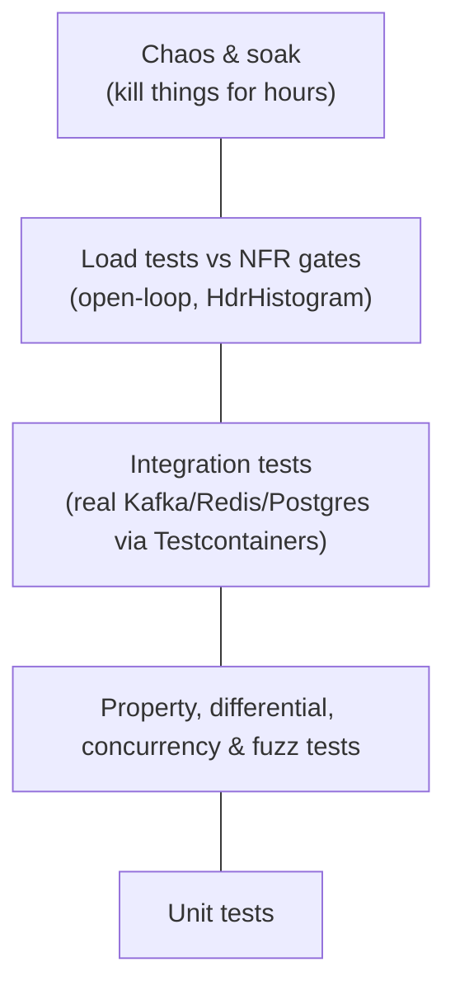

# Engineering Practices

The rules that make this a coding-skills project, not just an infrastructure tour. They apply to every phase. Stack: **Java 25 + Spring Boot**, with guardrails ([ADR-0010](adr/0010-java-and-spring-boot.md)).

## 1. Testing pyramid



| Layer | Tooling | Required for |
|---|---|---|
| Unit | JUnit 5 + AssertJ | Everything |
| Property-based | [jqwik](https://jqwik.net/) | Engine, risk math, ledger posting logic |
| Differential | Reference implementation, same inputs | Engine (naive engine), Phase 7 (real Redis/Kafka) |
| Concurrency | [jcstress](https://github.com/openjdk/jcstress) for lock-free code (ring buffers, caches); stress tests with `ExecutorService` + `CountDownLatch` for races | Anything shared between threads |
| Fuzz | [Jazzer](https://github.com/CodeIntelligenceTesting/jazzer) | Decoders, API parsing, RESP parser |
| Architecture rules | [ArchUnit](https://www.archunit.org/) | `engine` has no Spring/I/O dependencies; no `double`/`float` in money code |
| Integration | [Testcontainers](https://java.testcontainers.org/) (+ `@SpringBootTest` slices) | Every service's Kafka/Redis/Postgres interaction |
| Load | `loadgen/` (open-loop), k6 for HTTP | Every NFR gate |
| Chaos | Toxiproxy, `docker kill`, `tc netem` | Every failure-table row |
| Soak | 4 h at 70% load | R1 |

### Invariant checkers as first-class code
`tools/invariants/` consumes `exec.events` and the ledger and continuously asserts D2/D3/D4. It runs in **every** load and chaos test, and in the "production" stack. The correctness dashboard must show flat zeros.

### Race detection in Java
Java has no built-in `-race` flag like Go. Instead:
- **jcstress** for anything lock-free or using `volatile`/`VarHandle`
- **Stress tests** that hammer shared state from many threads and assert invariants
- **Thread-confinement by design:** the engine is single-threaded (ADR-0003); document the owning thread of every mutable object (see [architecture §12](architecture.md#12-concurrency-model))
- Static analysis: Error Prone + `@GuardedBy` annotations

## 2. Benchmarking discipline

- Microbenchmarks: **JMH** only (hand-written timing loops lie because of JIT warm-up, dead-code elimination and on-stack replacement).
  - `@Fork(3)`, warm-up iterations, `Blackhole` for results
  - `-prof gc` → allocations per op (R2 requires ≈ 0 B/op)
  - `-prof async` (async-profiler integration) → flamegraphs per benchmark
- **CI regression gate:** benchmark results stored per commit; a > 5% regression on key benchmarks fails the build (O5).
- Load tests:
  - **Open-loop** scheduling (avoid coordinated omission)
  - **Warm-up period excluded** (JIT compilation takes seconds to minutes)
  - Report p50/p90/p99/p99.9/max + throughput achieved vs offered
  - Record hardware, JDK version, GC, heap flags and config with every result
- Control noise: fixed CPU governor, nothing else running, repeat 3×.

## 3. The perf log

Every optimization gets a file `perf-log/NNN-short-title.md`:

```markdown
# 007: Array-indexed price levels

## Hypothesis
TreeMap lookups + entry allocation dominate add-order time
(async-profiler: 38% in TreeMap.put / getEntry; JMH -prof gc: 48 B/op).

## Baseline
OrderBookBench.addOrder: 412 ns/op, 48 B/op  (JMH, 3 forks × 10 iterations)
Flamegraph: perf-log/img/007-before.html

## Change
Replaced TreeMap<Long, Level> with Level[] indexed by (priceTicks - floorTicks), plus best-price cursor.

## Result
OrderBookBench.addOrder: 96 ns/op, 0 B/op  (−77%)
Flamegraph: perf-log/img/007-after.html

## Trade-offs
Memory: 40 KB per book for ±10% band. Breaks if price moves outside band → re-centre operation added.

## Lessons
...
```

This log becomes the most valuable artifact of the project: evidence that you can measure, reason and improve.

## 4. Profiling checklist

When a gate fails, in this order:
1. Is the **load generator** the bottleneck? (Check its CPU; run it on separate cores.)
2. Has the JVM **warmed up**? (Exclude the first minutes; check JIT activity in JFR.)
3. **Where** is the latency? (Trace → which hop.)
4. CPU-bound? → async-profiler CPU mode → flamegraph.
5. Allocation/GC-bound? → async-profiler `alloc` mode, GC logs (`-Xlog:gc*`), JFR GC pause events.
6. Blocking / lock contention? → async-profiler `lock` mode, JFR thread-park and monitor events, thread dumps (`jcmd <pid> Thread.print`).
7. Framework overhead? → look for Spring proxy, Jackson or reflection frames in the flamegraph.
8. I/O-bound? → Kafka batch sizes, Redis round trips (pipelining?), Postgres commit counts, connection pool waits (HikariCP metrics).
9. Fix **one** thing, re-measure, log it.

## 5. Code standards

- **Java 25**, Maven (multi-module, Maven Wrapper, versions pinned in the parent POM's `dependencyManagement`/`pluginManagement`); **Spotless** (google-java-format) and **Error Prone** in CI.
- **Modules:** `engine` depends on nothing but the JDK (and Agrona). Enforced by ArchUnit.
- **Spring guardrails** ([ADR-0010](adr/0010-java-and-spring-boot.md)):
  - Constructor injection only; no field `@Autowired`
  - No `@KafkaListener` in the matcher; raw clients elsewhere until you can explain what Spring Kafka does
  - No JPA on the ledger; `JdbcClient` + explicit SQL
  - Every `@Transactional` states its isolation level
  - Virtual threads on for request handling; thread pools you create yourself are named and metered
- **Errors:** exceptions carry context; never swallow (`catch (Exception e) {}` fails review).
- **Timeouts:** every network call has an explicit timeout. No unbounded waits.
- **Graceful shutdown:** `server.shutdown=graceful`; consumers stop polling, finish the batch, commit, close (`SmartLifecycle`).
- **Config:** `@ConfigurationProperties` records; every tunable (batch sizes, timeouts, pool sizes) is a property. They're all experiment knobs.
- **Logging:** SLF4J + JSON encoder; never on hot paths; sample high-frequency logs.
- **Metrics:** Micrometer, with RED + domain metrics from day one.
- **Money:** primitive `long` with unit-suffixed names on the hot path, records at boundaries ([ADR-0004](adr/0004-integer-fixed-point-money.md)). `double`/`float`/`BigDecimal` in money code outside the gateway fails review (ArchUnit rule).
- **Hot path:** no streams, lambdas, boxing, `String.format` or logging. Primitive collections (Agrona).

## 6. Git workflow

- Small commits, one logical change each; conventional commit messages (`feat(engine): …`, `perf(matcher): …`, `test(oms): …`).
- Feature branches + PRs, even solo. Review your own diff before merging, or ask Claude to review it.
- Each phase ends with a tag (`phase-1-done`) and a short write-up in `docs/design/phase-N-retro.md`.

## 7. Definition of done (for any feature)

- [ ] Unit + property/integration tests; concurrency tests for anything shared between threads
- [ ] Metrics added and visible on a dashboard
- [ ] Load test run; affected NFR gates still pass
- [ ] Failure behaviour considered (what if it crashes mid-way?) and tested where it matters
- [ ] Docs/ADRs updated if a decision changed
