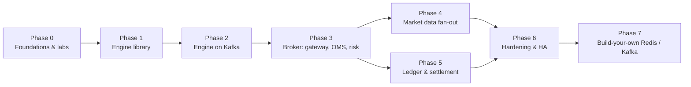
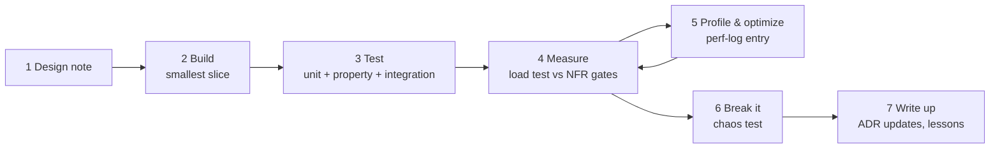

# Roadmap & Workflow

Each phase has **learning goals**, **deliverables**, **NFR gates** (numbers you must hit), and a **definition of done**. A phase isn't finished when it works. It's finished when it's **measured, tested and written up**.

> **Why the order changed from our first discussion:** originally "build a Redis clone" came first. Since you haven't used Redis or Kafka yet, you'll **use** them first (Phases 0–6) and **build** your own at the end (Phase 7), when you'll know exactly which behaviours matter.

Rough timings assume ~10–15 h/week. They're guides, not deadlines.

---

## Phase 0: Foundations & labs (1–2 weeks)

**Learning goals:** the domain; Kafka, Redis and Postgres basics by hand (raw Java clients first); Docker Compose; Prometheus/Grafana basics; Maven multi-module + Spring Boot project skeleton.

**Deliverables**
- [ ] Read Trading 101 + glossary, and the [system walkthrough](system-walkthrough.md)
- [ ] `deploy/docker-compose.yml`: 3-broker Kafka (KRaft), **Kafka UI**, Redis + Sentinel, Postgres + PgBouncer, Prometheus, Grafana, Jaeger, Toxiproxy (HAProxy and MinIO are added in later phases, [ADR-0011](adr/0011-supporting-infrastructure.md))
- [ ] Maven multi-module skeleton (parent POM + wrapper): `engine`, `common`, one empty Spring Boot service with Actuator + Micrometer + Prometheus endpoint, CI running tests
- [ ] `labs/kafka/`: labs 1–7 from [kafka.md](tech/kafka.md#9-hands-on-labs-phase-0), each with a short `NOTES.md` of what you observed
- [ ] `labs/redis/`: labs 1–7 from [redis.md](tech/redis.md#10-hands-on-labs-phase-0)
- [ ] `labs/postgres/`: lost-update lab

**Done when:** you can explain, without notes: partitions vs consumer groups, `acks=all` + `min.insync.replicas`, why Redis Lua is atomic, why Redis can lose writes, what an outbox is.

---

## Phase 1: Matching engine library (2–3 weeks)

**Learning goals:** data structures under performance pressure, allocation-free Java (object pools, primitive collections), property-based and differential testing, benchmarking discipline.

**Deliverables**
- [ ] `engine` module: plain Java, **no Spring, no I/O** (ArchUnit-enforced). API: `process(command, eventSink)` with primitive types per ADR-0004
- [ ] Limit, market (with price protection), IOC, cancel, self-trade prevention
- [ ] The worked matching example from Trading 101 as a golden test
- [ ] Naive **reference engine** for differential testing
- [ ] Property tests (jqwik) for engine invariants: no order fills beyond its quantity; the book is never crossed after matching (best bid < best ask); quantity is conserved (filled + resting + cancelled = submitted); price-time priority holds; same input gives the same output
- [ ] JMH benchmarks with realistic order mixes; `-prof gc` for allocations
- [ ] Two price-level implementations (sorted map vs tick-array) compared in `perf-log/`
- [ ] Snapshot/restore of engine state + determinism test

**NFR gates:** T1 ≥ 1M orders/s single thread · L1 p99 ≤ 10 µs · R2 zero allocs/order · D5 deterministic replay

**Done when:** gates pass in CI, and `perf-log/` has ≥ 3 optimization entries with flamegraphs.

---

## Phase 2: Engine as a Kafka service (2–3 weeks)

**Learning goals:** event sourcing, Kafka transactions, consumer groups and rebalances, crash recovery, I/O vs compute separation.

**Deliverables**
- [ ] Protobuf event schemas in `pkg/events`
- [ ] `services/matcher`: consumer → ring buffer → engine → ring buffer → transactional producer
- [ ] Snapshots to local disk + recovery (ADR-0009); optional: MinIO as snapshot store
- [ ] A simple command-line producer for orders + an invariant-checker consumer (D2)
- [ ] Prometheus metrics: orders/s, batch size, transaction commit latency, lag
- [ ] Experiments: transaction batch size vs latency/throughput; `ArrayBlockingQueue` vs Disruptor; G1 vs ZGC; `linger.ms` sweep

**NFR gates:** A1 recovery ≤ 10 s with 1M resting orders · D2 zero double fills across 100 `kill -9` cycles under load · sustained 10k orders/s through the matcher

**Done when:** a chaos script kills the matcher in a loop for 30 minutes and the invariant checker reports zero violations.

---

## Phase 3: Broker: gateway, OMS, risk (3 weeks)

**Learning goals:** Redis Lua atomicity, rate limiting, idempotency, race conditions, crash windows, async request flows.

**Deliverables**
- [ ] `services/gateway`: REST API, API keys, token-bucket rate limiter, idempotency keys; 2 instances behind **HAProxy**
- [ ] `services/oms`: validation, Lua reserve/release/fill scripts, Kafka producer, exec-event consumer, order projection in Postgres, private WS channel for execution reports
- [ ] Reservation sweeper for leaked reservations
- [ ] `loadgen/`: trader + market-maker bots, **open-loop** with HdrHistogram
- [ ] Tracing across gateway → OMS → Kafka → matcher → OMS
- [ ] Stress tests: 1,000 concurrent orders on one account (D4); retry storm with injected timeouts (D6)

**NFR gates:** L2 p99 ≤ 15 ms · L3 p99 ≤ 50 ms · L5 p99 ≤ 1 ms · T2 10k orders/s · D4, D6

**Done when:** end-to-end load test at 10k orders/s meets the gates, and the crash-window tests pass (OMS crash after reserve / after Kafka ack, [architecture §8](architecture.md#8-failure-modes)).

---

## Phase 4: Market data fan-out (2 weeks)

**Learning goals:** pub/sub, WebSockets at scale, backpressure, conflation, sequence-number protocols.

**Deliverables**
- [ ] `services/marketdata`: L2 builder, snapshots in Redis, Pub/Sub deltas
- [ ] `services/wsgateway`: subscribe protocol, snapshot + delta, conflation, slow-consumer disconnect; 3 instances behind HAProxy
- [ ] Experiment: Spring WebSocket on virtual threads vs Spring WebFlux (Netty) for 10k connections
- [ ] `services/candles`: 1s / 1m candles with event-time + watermark
- [ ] WS subscriber simulator with a slow-client fraction
- [ ] Experiment: Redis Pub/Sub vs Redis Streams vs direct Kafka consumption (latency, CPU, recovery)

**NFR gates:** L4 p99 ≤ 50 ms at T4 (10k clients) · R4 slow-client isolation

**Done when:** a 10k-client test runs for 30 minutes within the gates, and the client-side gap detector reports only gaps that were recovered.

---

## Phase 5: Ledger & settlement (2–3 weeks)

**Learning goals:** Postgres transactions and isolation, double-entry, idempotent consumers, batching, outbox, reconciliation.

**Deliverables**
- [ ] `services/ledger`: batched settlement, `TradeSettlement` handling, dedupe, balances, outbox + relay
- [ ] `account.events` → OMS Redis sync with versioning
- [ ] Reconciliation job + correctness dashboard
- [ ] Positions & realized/unrealized P&L API
- [ ] Experiments: batch size vs lag; hot-account aggregation; isolation levels

**NFR gates:** L6 p99 ≤ 1 s · T5 20k trades/s burst, lag recovers ≤ 60 s · D3 zero imbalance

**Done when:** a full-system load test runs for 1 hour with all reconciliation checks at zero.

---

## Phase 6: Hardening & high availability (3+ weeks)

**Learning goals:** chaos engineering, soak testing, HA patterns, fencing, capacity planning, tuning across the stack.

**Deliverables**
- [ ] `chaos/` scenarios for every row in the [failure table](architecture.md#8-failure-modes) and the [walkthrough's crash tables](system-walkthrough.md#16-when-things-crash)
- [ ] Snapshots moved to MinIO; matcher hot standby + fencing (A2)
- [ ] Redis Sentinel failover + rebuild procedure (A4)
- [ ] Postgres replica + failover
- [ ] Hot-symbol work: dedicated partition, transaction batching tuning (T3)
- [ ] 4-hour soak test (R1)
- [ ] Optional: move to Kubernetes (kind/k3d), add autoscaling for stateless services
- [ ] **Capacity report:** "this system on this hardware handles X with p99 Y; the bottleneck is Z; scaling to 10× needs W"

**NFR gates:** all of A1–A6, R1–R4, T3

**Done when:** every NFR in [requirements.md](requirements.md) has a passing, repeatable test and a dashboard panel.

---

## Phase 7: Build-your-own (stretch, open-ended)

**Learning goals:** how the tools you've used actually work inside.

| Project | Scope | Gate |
|---|---|---|
| **Redis-lite** | RESP protocol, GET/SET/DEL/EXPIRE/INCR, hashes, EVAL-free equivalents of our scripts, Pub/Sub, AOF | Passes differential tests vs real Redis; within 2× of `redis-benchmark` numbers; the broker runs on it |
| **Kafka-lite** | Segmented log, offset index, produce/fetch, consumer offsets, (stretch) replication | Crash-loop test: zero acknowledged-message loss; 300 MB/s sequential write; the matcher runs on it |
| **Off-heap engine** | Store the book in off-heap memory (`MemorySegment` / Agrona buffers): zero GC pressure | Same property/differential tests; compare GC and p99.9 with the on-heap engine |
| **Custom sequencer/journal** | Replace Kafka on the order path with a replicated in-memory journal (ADR-0002 option C) | Order-ack p99 < 1 ms |

---

## Working rhythm (every phase)

1. **Design first.** Write a 1-page design note in `docs/design/phase-N.md` (or update ADRs) before coding.
2. **Smallest slice.** Get one order through end to end before adding features.
3. **Tests alongside code**, not after.
4. **Measure against the gate.** No "it feels fast".
5. **Optimize only what the profiler shows.** One change at a time, with a `perf-log/` entry.
6. **Break it on purpose.**
7. **Write it up.** What surprised you? What would you do differently? This becomes your portfolio.
