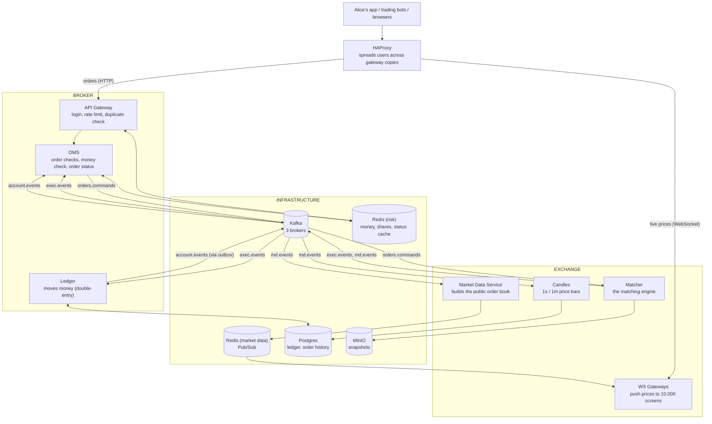
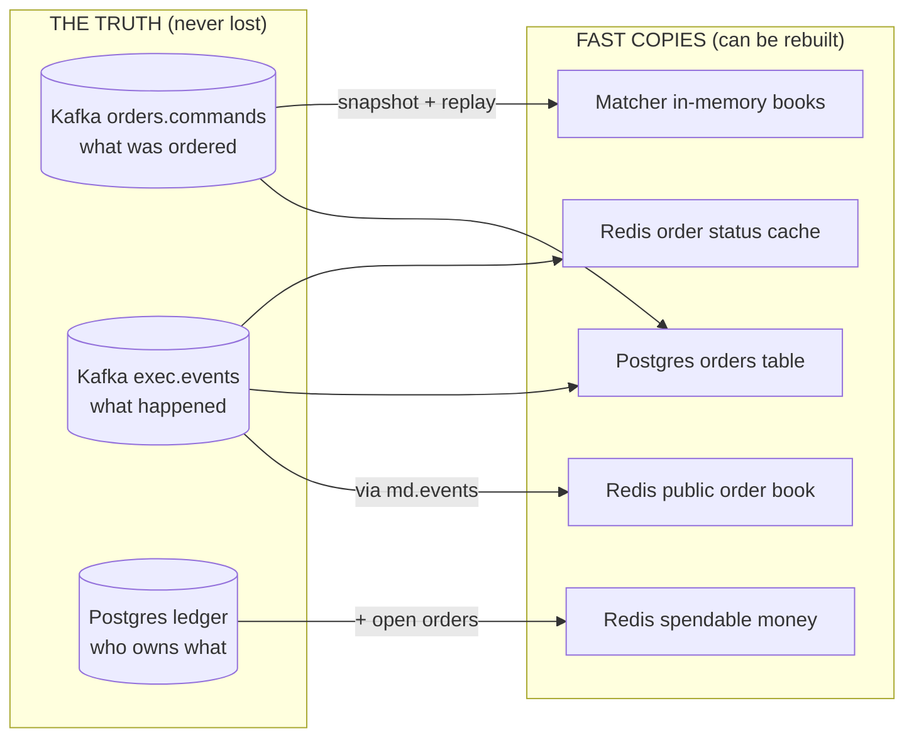
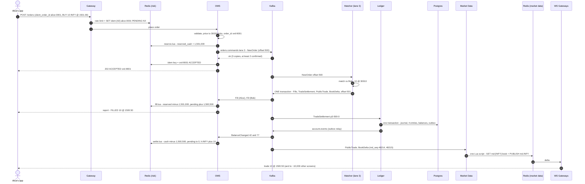
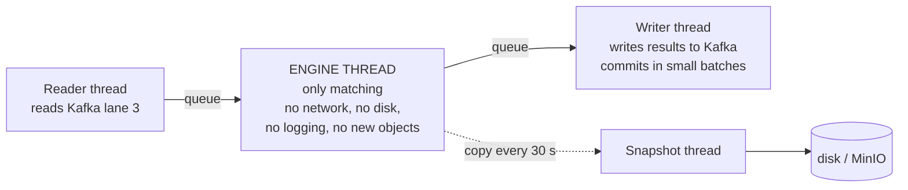
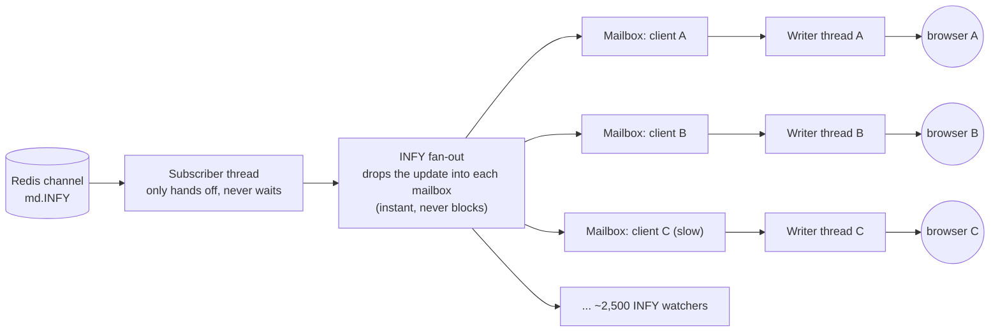
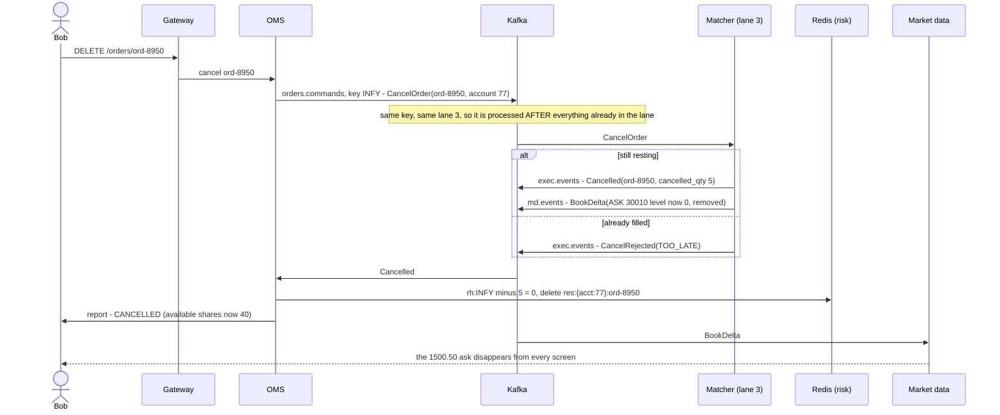
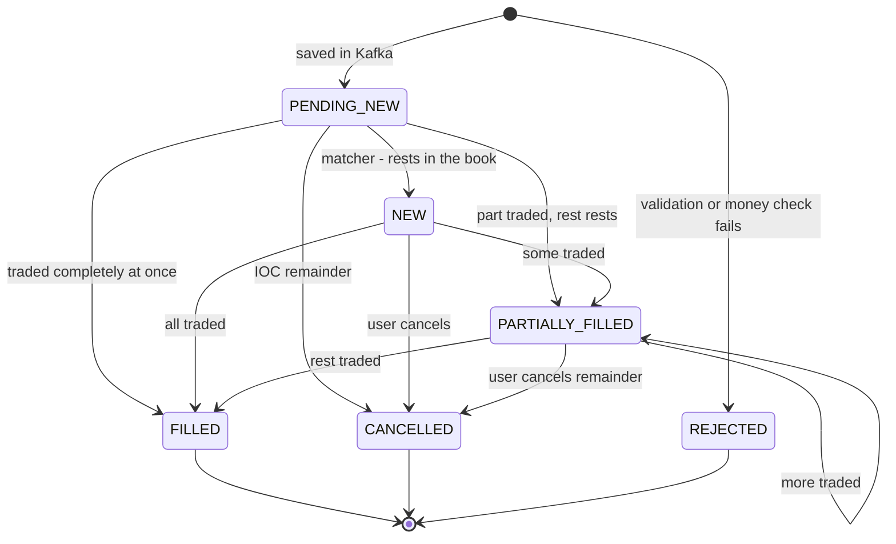
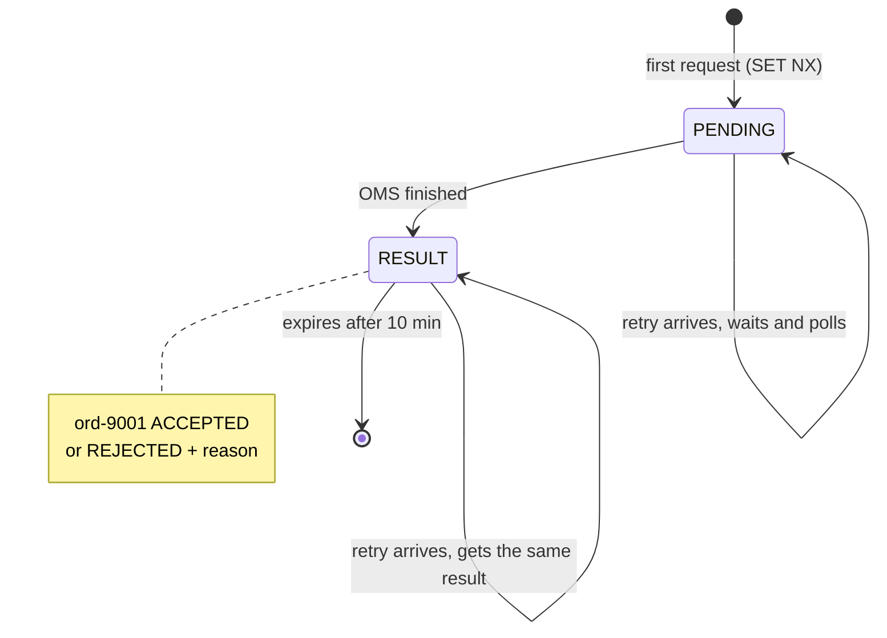
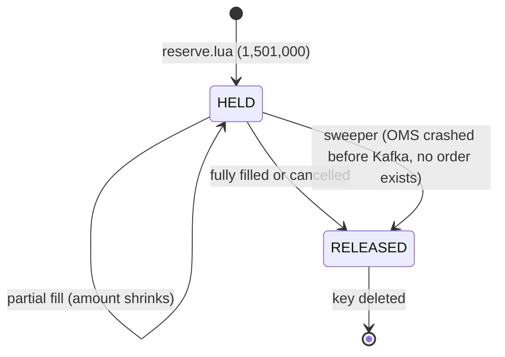

# The Whole System, Start to Finish

This is the **one document** that puts everything together. It follows a single order, from the moment
Alice taps **Buy** to the moment 10,000 screens show the new price and the money has moved in the
books. At every step it shows **what is saved, where, and exactly what the saved data looks like**.

It uses plain language, with Mermaid diagrams for flows and code blocks for exact saved data. When a
technical word appears for the first time, it's explained right there. The "why" behind each choice lives in the ADRs (`docs/adr/`); this doc links to them but
doesn't repeat the arguments.

**How to read it:** chapters 1–3 set the stage. Chapters 4–12 are the journey of one order, step by
step. Chapters 13–17 cover cancels, crashes, and the rules that keep everything correct.

---

## Contents

1. [The cast: every component in one picture](#1-the-cast-every-component-in-one-picture)
2. [Where data lives: truth vs copies](#2-where-data-lives-truth-vs-copies)
3. [The scenario we'll follow](#3-the-scenario-well-follow)
- [The whole journey in one diagram](#the-whole-journey-in-one-diagram)
4. [Step 1: Alice taps Buy (what the app sends)](#4-step-1-alice-taps-buy)
5. [Step 2: The gateway (rate limit + duplicate check)](#5-step-2-the-gateway)
6. [Step 3: The OMS (validate, order ID, money check)](#6-step-3-the-oms)
7. [Step 4: Kafka saves the order (the moment it becomes real)](#7-step-4-kafka-saves-the-order)
8. [Step 5: The matcher (the trade happens)](#8-step-5-the-matcher)
9. [Step 6: The OMS hears about the fill](#9-step-6-the-oms-hears-about-the-fill)
10. [Step 7: The ledger moves the money](#10-step-7-the-ledger-moves-the-money)
11. [Step 8: Redis catches up with the ledger](#11-step-8-redis-catches-up-with-the-ledger)
12. [Step 9: Market data reaches 10,000 screens](#12-step-9-market-data-reaches-10000-screens)
13. [The full timeline and the speed targets](#13-the-full-timeline-and-the-speed-targets)
14. [Cancelling an order](#14-cancelling-an-order)
15. [Every state, in one place](#15-every-state-in-one-place)
16. [When things crash: what saves us at each step](#16-when-things-crash)
17. [The rules that keep it all correct](#17-the-rules-that-keep-it-all-correct)
18. [Mini glossary](#18-mini-glossary)

---

## 1. The cast: every component in one picture



| Component | One-line job | Side |
|---|---|---|
| **HAProxy** | Receptionist: sends each user to the least busy gateway copy | edge |
| **API Gateway** | Front door for orders: checks who you are, how fast you're sending, and whether this is a repeat | broker |
| **OMS** (Order Management Service) | Checks the order makes sense, checks you can afford it, tracks its status | broker |
| **Kafka** | A set of append-only logs. Once something is written, it stays, in order | infra |
| **Matcher** | The matching engine: holds the order books and makes trades | exchange |
| **Ledger** | The accountant: records every rupee and share that moves, in Postgres | broker |
| **Market Data Service** | Builds the public order book from trades and publishes changes | exchange |
| **WS Gateways** | Hold open connections to browsers and push price updates | exchange |
| **Candles** | Builds price bars (open/high/low/close per second and minute) for charts | exchange |
| **Redis (risk)** | Super-fast memory store: everyone's spendable money, idempotency keys, rate limits | infra |
| **Redis (market data)** | A separate Redis just for broadcasting prices, so price traffic never slows money checks | infra |
| **Postgres** | The database: the ledger (the real money) and order history | infra |
| **MinIO** | File storage (works like Amazon S3) for the matcher's snapshots | infra |

### The four Kafka topics

A **topic** is a named log. Each topic is split into **partitions** ("lanes"). Within one lane,
order is guaranteed. Every message has a **key**; the same key always goes to the same lane.

| Topic | Key (picks the lane) | Lanes | Written by | Read by | What's in it |
|---|---|---|---|---|---|
| `orders.commands` | symbol (e.g. `INFY`) | 16 | OMS | Matcher | New orders, cancel requests |
| `exec.events` | symbol | 16 | Matcher | OMS, Ledger, invariant checker | Fills, cancels, trade settlements |
| `md.events` | symbol | 16 | Matcher | Market Data Svc, Candles | Public trades, order book changes |
| `account.events` | account ID | 8 | Ledger (via outbox) | OMS | "Alice's cash/shares changed" |

Every topic keeps **3 copies** of each message on 3 brokers, and a write only counts once at least
**2** copies have it (`replication.factor=3`, `min.insync.replicas=2`, `acks=all`).

---

## 2. Where data lives: truth vs copies

The most important idea in the whole design: **some places hold the truth, others hold fast copies
that can be rebuilt from the truth.**



| Data | Lives in | Truth or copy? | If lost... |
|---|---|---|---|
| Orders people placed | Kafka `orders.commands` | **Truth** ([ADR-0002](adr/0002-event-sourced-core-with-kafka.md)) | Can't happen: 3 copies, written before we say "accepted" |
| Trades / fills | Kafka `exec.events` | **Truth** | Same |
| Cash and shares owned | Postgres ledger | **Truth** ([ADR-0008](adr/0008-double-entry-ledger-in-postgres.md)) | Database backups/replica |
| Order books (who's waiting to buy/sell) | Matcher memory | Copy | Load snapshot + replay Kafka ([ADR-0009](adr/0009-snapshots-and-replay-recovery.md)) |
| Spendable money ("buying power") | Redis | Copy | Recompute from ledger + open orders ([ADR-0005](adr/0005-pre-trade-risk-in-redis.md)) |
| Order status for quick lookup | Redis + Postgres `orders` table | Copy | Re-read Kafka |
| Public order book & last price | Redis (market data) | Copy | Rebuilt from `md.events` |
| Old orders for audit | Postgres `order_commands` | Permanent archive | Backups |

---

## 3. The scenario we'll follow

Two customers, one stock (INFY), one trade.

**Money and prices are always whole numbers inside the system** ([ADR-0004](adr/0004-integer-fixed-point-money.md)):
- **Prices** are counted in **ticks**. The exchange only allows prices in steps of ₹0.05, so we
  store "which step": `price_ticks = price ÷ 0.05`. ₹1500.50 → **30,010**. ₹1501.00 → **30,020**.
- **Money** is counted in **paise**. ₹20,000.00 → **2,000,000**.
- Cost of a trade = `qty × price_ticks × 5` paise (one tick = 5 paise).
- Decimals like "1500.50" only exist at the edges (the gateway converts them).

In the tables below you'll see both, e.g. `2,000,000 (₹20,000)`.

### Before anything happens

**Alice** (account 42): ₹20,000 cash, no shares. She has never traded.

**Bob** (account 77): ₹10,000 cash, owns 50 INFY. Earlier today he placed an order to
**sell 15 INFY at ₹1500.50** (order `ord-8950`). Nobody has bought yet, so it's **resting** in the
book. Bob's 15 shares are **reserved** (held back) so he can't sell them twice.

**The INFY order book** (lives in the matcher's memory, lane 3):

```
           BIDS (people wanting to buy)          ASKS (people wanting to sell)
   price          qty   who                  price          qty   who
   ₹1500.00 (30,000)  20  Dave               ₹1500.50 (30,010)  15  Bob   ord-8950  <- best ask
                                             ₹1501.50 (30,030)  40  Carol
```

**Redis (risk) before:**

```
 {acct:42}  Alice                              {acct:77}  Bob
   cash           = 2,000,000  (₹20,000)          cash           = 1,000,000  (₹10,000)
   reserved_cash  = 0                             reserved_cash  = 0
   pending_cash   = 0                             pending_cash   = 0
   h:INFY         = 0     (shares held)           h:INFY         = 50
   rh:INFY        = 0     (shares reserved)       rh:INFY        = 15   <- for ord-8950
   ph:INFY        = 0     (shares pending)        ph:INFY        = 0

                                                res:{acct:77}:ord-8950 = { qty: 15, created_ts: ... }
```

**Spendable ("available") is always calculated, never stored:**

```
 available cash   = cash - reserved_cash - pending_cash
 available shares = h - rh - ph

 Alice: 2,000,000 - 0 - 0 = 2,000,000 (₹20,000)        Bob shares: 50 - 15 - 0 = 35
```

(What `pending` means is explained in step 6. For now it's 0.)

**Postgres ledger balances before:**

```
 balances
   account  asset   amount
   42       INR     2,000,000
   77       INR     1,000,000
   77       INFY    50
```

---

## The whole journey in one diagram

Keep this open while reading chapters 4–12. The numbers match the steps.



---

## 4. Step 1: Alice taps Buy

Alice wants **10 INFY**, and she's willing to pay **at most ₹1501.00** each.

Her app does two things **before** sending:

1. Makes up a unique ID for this order: `client_order_id = "alice-0001"` (usually a UUID).
2. **Saves it on the phone** first. If the app crashes and restarts, it retries with the **same**
   ID. That's how the system can tell a *retry* from a *new order* (§5).

What actually goes over the network:

```
POST /orders                                   (over HTTPS, through HAProxy)
X-API-Key: ak_alice_...                        <- who is calling (maps to account 42)
Content-Type: application/json

{
  "client_order_id": "alice-0001",     <- made by the app; same value on every retry
  "symbol":          "INFY",
  "side":            "BUY",
  "type":            "LIMIT",          <- "LIMIT" = don't pay more than my price
  "qty":             10,
  "price":           "1501.00",        <- sent as TEXT, never as a floating-point number
  "tif":             "DAY"             <- time in force: if not filled, stay in the book today
}
```

**Saved so far:** only `alice-0001` on Alice's phone.

---

## 5. Step 2: The gateway

HAProxy passes the request to one of the gateway copies. The gateway does four quick things.

### 5.1 Who is this?
It looks up the API key → **account 42**.

### 5.2 Is Alice sending too fast? (rate limit)
A tiny Lua script in Redis counts Alice's recent requests (key `rl:{42}`). Too many per second →
reply `429 Too Many Requests`. This protects the system from a buggy bot.

### 5.3 Is the request too old?
If the request's timestamp is older than the retry window (10 minutes), reply `REQUEST_EXPIRED`.
(Why: §5.4's duplicate note only lives 10 minutes, so a very late retry could otherwise sneak through
as a "new" order. [ADR-0006](adr/0006-exactly-once-processing.md))

### 5.4 Have we seen this order before? (the idempotency check)

**Idempotent** means "doing it twice has the same effect as doing it once". The gateway builds a
key from the account and Alice's ID and tries to claim it:

```
 SET idem:{42}:alice-0001  "PENDING"  NX  EX 600
                                       |     |
             NX = only if it doesn't --+     +-- auto-delete after 600 s (10 min)
                  exist yet
```

| Redis replies | Meaning | Gateway does |
|---|---|---|
| `OK` | First time we've seen `alice-0001` | Continue to the OMS |
| `nil` | Already exists: this is a **retry** | `GET` the key. If it holds a result → return that same result. If still `"PENDING"` → wait a little and check again. **Never** create a second order |

**Saved now (Redis, risk):**

```
 idem:{42}:alice-0001 = "PENDING"            (expires in 10 min)
 rl:{42}              = (request counter)
```

---

## 6. Step 3: The OMS

### 6.1 Does the order make sense? (validation)

| Check | Alice's order | Result |
|---|---|---|
| Symbol exists? | INFY | ✅ |
| Price on a ₹0.05 step? | "1501.00" → `1501.00 × 20 = 30,020` exactly | ✅ (₹1501.03 would give 30,020.6 → **reject**, never round) |
| Quantity within limits? | 10 ≤ max | ✅ (stops overflow tricks, [ADR-0004](adr/0004-integer-fixed-point-money.md)) |
| Price within ±10% of last price? | yes | ✅ (stops "fat finger" mistakes) |

The text `"1501.00"` is converted **straight from the string** with `BigDecimal` to `30,020`. From
here on, every price is a whole number.

### 6.2 Give the order its official name

`order_id = "ord-9001"`. (Real IDs are time-ordered, so a recent ID can be recognised as recent.)
This happens **before** the money check, because the money reservation is recorded under this ID.

### 6.3 Can Alice afford it? (the money check)

Worst-case cost = what she'd pay at her limit price:

```
 10 × 30,020 × 5 = 1,501,000 paise  (₹15,010)
```

The OMS runs `reserve.lua` inside Redis. Redis runs one script at a time, so **nothing can sneak in
between the check and the reserve**. Even if Alice fires two orders at the same instant to two
different OMS machines, one script finishes before the other starts:

```
 reserve.lua(account 42, order ord-9001, amount 1,501,000)
   available = cash - reserved_cash - pending_cash  = 2,000,000 - 0 - 0 = 2,000,000
   if available < 1,501,000  -> return REJECT
   reserved_cash += 1,501,000
   create res:{acct:42}:ord-9001 = { amount_paise: 1,501,000, created_ts: 10:00:00.000 }
   return OK
```

(`{acct:42}` in curly braces is a **hash tag**: it keeps all of Alice's keys on the same Redis
server, so one script can update them together.)

If the check fails → the order is **REJECTED** right here, never reaches the exchange, and the
gateway stores the rejection in `idem:{42}:alice-0001`.

**Saved now (Redis, risk):**

```
 {acct:42}                cash = 2,000,000   reserved_cash = 1,501,000   pending_cash = 0
 res:{acct:42}:ord-9001   { amount_paise: 1,501,000, created_ts: 10:00:00.000 }

 Alice available = 2,000,000 - 1,501,000 - 0 = 499,000  (₹4,990)
```

---

## 7. Step 4: Kafka saves the order

### 7.1 The write that makes the order real

The OMS sends the order to Kafka topic `orders.commands`:

```
 topic:  orders.commands
 key:    "INFY"            <- only used to pick the lane: hash("INFY") % 16 = 3.
                              (Not a duplicate check! Every INFY order lands in lane 3, in order.)
 value:  Envelope {
           event_id:   "ord-9001-new"
           ts_nanos:   10:00:00.001 (stamped by the OMS; the engine uses this, never its own clock)
           trace_parent: "00-4bf9...-01"     (for tracing the request across services)
           body: NewOrder {
             order_id:          "ord-9001"
             account_id:        42
             symbol:            "INFY"
             side:              BUY
             type:              LIMIT
             tif:               DAY
             qty:               10
             limit_price_ticks: 30020
             client_order_id:   "alice-0001"
             accepted_ts:       10:00:00.001
           }
         }
```

Kafka writes it to lane 3 at position **offset 500**, copies it to at least 2 brokers, then replies
"ok, partition 3, offset 500".

**This is the moment the order officially exists.** Before this, a crash could lose it (and the
client never got a "yes"). After this, it can't be lost.

**Hidden duplicate protection (automatic):** if the "ok" got lost and the Kafka client resent the
message, the broker would recognise it by the producer's ID and sequence number (PID 17, seq 42) and
drop the copy. We write no code for this; it's the setting `enable.idempotence=true`.

### 7.2 Reply to Alice

```
 Redis:  SET idem:{42}:alice-0001  '{"order_id":"ord-9001","status":"ACCEPTED"}'  EX 600
 Redis:  SET order:ord-9001        '{"status":"PENDING_NEW","version":0}'          EX 600
         (best-effort status cache; if this write fails, the order still succeeds)

 HTTP 202  { "order_id": "ord-9001", "status": "ACCEPTED" }
```

"ACCEPTED" means "**we have it safely**". It does **not** mean "traded" yet.

If this reply is lost and Alice's app retries `alice-0001`, step 2 finds the key and returns
`ord-9001` again. **No second order.**

### 7.3 Copies that get built from this message (in the background)

- **Postgres `orders` table** (order history projection): a consumer reads the message and inserts
  ```
  orders: ord-9001 | acct 42 | INFY | BUY | qty 10 | limit 30020 | filled 0 | PENDING_NEW | version 0
  ```
- **Postgres `order_commands`** (permanent audit archive): the raw message is appended. Kafka only
  keeps 7 days; this keeps it forever.

Consumers save their Kafka position (**commit the offset**) only **after** their database write
succeeds. If Postgres is down, they simply wait and retry later. Nothing is lost.

**Saved now:**

```
 Kafka   orders.commands  lane 3  offset 500  = NewOrder ord-9001       (3 copies)
 Redis   idem:{42}:alice-0001 = {ord-9001, ACCEPTED}
 Redis   order:ord-9001 = {PENDING_NEW, v0}
 Postgres orders (ord-9001, PENDING_NEW, v0), order_commands (raw copy)
```

---

## 8. Step 5: The matcher

### 8.1 Who handles lane 3?

Exactly **one thread** in the whole system owns lane 3 and every order book in it (INFY, TCS,
WIPRO...). Nobody else may touch those books, so no locks are needed, and the results are always the
same for the same input ([ADR-0003](adr/0003-single-threaded-matching-per-shard.md)).

Inside the matcher, lane 3 has a small assembly line of threads:



The engine thread never waits on the network, so a slow Kafka call can't freeze matching.

### 8.2 The match

The engine reads offset 500: "BUY 10 INFY, limit 30,020".

```
 best ask = Bob, 15 @ 30,010.     30,010 <= 30,020 ?  yes -> TRADE
 trade qty   = min(10, 15) = 10
 trade price = 30,010              <- the RESTING order's price (Bob's). Alice gets a better
                                      price than her limit: "price improvement" (₹0.50 per share)
 Alice: 10 - 10 = 0 left  -> FILLED
 Bob:   15 - 10 = 5 left  -> PARTIALLY FILLED, still resting
```

**The INFY book after:**

```
           BIDS                                  ASKS
   ₹1500.00 (30,000)  20  Dave               ₹1500.50 (30,010)   5  Bob   ord-8950
                                             ₹1501.50 (30,030)  40  Carol
```

(If Alice had wanted 20, she would have bought Bob's 15, and her other 5 would rest in the book as a
bid at ₹1501.00. Bob is the **maker**: his order was already waiting. Alice is the **taker**: her
order arrived and took it.)

### 8.3 The IDs: built from where the input came from

```
 trade_id = "p3-500-0"   = lane 3, offset 500, first trade this input caused
 event IDs = "p3-500-e0", "p3-500-e1", ...   = the 1st, 2nd, ... message produced for offset 500
```

There's no randomness, so if offset 500 is ever processed again (replay), it produces **the same IDs**.
That's what lets later steps spot duplicates ([ADR-0006](adr/0006-exactly-once-processing.md)).

### 8.4 What the matcher writes: all in ONE Kafka transaction

```
 BEGIN TRANSACTION   (transactional ID "matcher-p3")

   exec.events  lane 3:
     p3-500-e0  Fill { order_id: ord-9001, account: 42, side: BUY,  fill_qty: 10,
                       fill_price_ticks: 30010, leaves_qty: 0, trade_id: p3-500-0,
                       liquidity: TAKER, order_version: 1 }
     p3-500-e1  Fill { order_id: ord-8950, account: 77, side: SELL, fill_qty: 10,
                       fill_price_ticks: 30010, leaves_qty: 5, trade_id: p3-500-0,
                       liquidity: MAKER, order_version: 2 }
     p3-500-e2  TradeSettlement { trade_id: p3-500-0, symbol: INFY, qty: 10, price_ticks: 30010,
                                  buyer: 42 / ord-9001, seller: 77 / ord-8950 }

   md.events  lane 3:
     p3-500-e3  PublicTrade { symbol: INFY, md_seq: 48214, trade_id: p3-500-0,
                              price_ticks: 30010, qty: 10, aggressor: BUY }
     p3-500-e4  BookDelta   { symbol: INFY, md_seq: 48215, side: ASK,
                              price_ticks: 30010, new_level_qty: 5 }

   consumer progress: "matcher group has finished orders.commands lane 3 up to 500 -> next is 501"

 COMMIT
```

- **Fill** (one per side): tells the OMS and each customer what happened to *their* order.
- **TradeSettlement** (one per trade, both sides together): what the ledger uses to move money. One
  message means the ledger can never post half a trade ([ADR-0008](adr/0008-double-entry-ledger-in-postgres.md)).
- **PublicTrade / BookDelta**: what the public sees. No account IDs. `md_seq` is INFY's market-data
  sequence number; it goes up by exactly 1 per message.
- **All of it, including the "done up to 500" note, becomes visible together or not at all.** If the
  matcher crashes before COMMIT, it's all thrown away and offset 500 gets processed again, with no
  duplicates.
- Readers use `read_committed`: they never see unfinished transactions.
- For speed, the writer thread commits every **5 ms or 500 messages**, whichever comes first, so one
  transaction usually covers many orders.

**Saved now:**

```
 Kafka  exec.events lane 3: Fill(Alice), Fill(Bob), TradeSettlement     (committed)
 Kafka  md.events   lane 3: PublicTrade #48214, BookDelta #48215          (committed)
 Kafka  consumer offset: matcher / orders.commands / lane 3 = 501
 Matcher memory: INFY book updated (Bob has 5 left)
```

### 8.5 Snapshots (every 30 s or 100,000 orders)

So the matcher can recover quickly after a crash, it regularly saves a **photo of all its books**:

```
 file: snap-p3-000000009000.bin  (example from earlier in the day)
   HEADER   format_version=1  partition=3  last_applied_offset=9000
   BOOK INFY  bids: [...in time order...]  asks: [...]  md_seq=...
   BOOK TCS   ...
   BOOK WIPRO ...
   CHECKSUM crc32c=...
```

The engine copies the books **between two orders** (never mid-update), and the snapshot thread
writes the copy: temp file → fsync (force it onto the disk) → rename (an all-or-nothing step) →
upload to MinIO → then update a `LATEST` pointer. The newest 3 are kept.

---

## 9. Step 6: The OMS hears about the fill

The OMS reads `exec.events` and gets both fills.

### 9.1 Alice's fill: update her money in Redis

```
 fill.lua(account 42, order ord-9001, trade p3-500-0, qty 10, limit 30,020, price 30,010)
   reserved_cash -= 10 × 30,020 × 5 = 1,501,000    (release the hold at her limit price)
   pending_cash  += 10 × 30,010 × 5 = 1,500,500    (what she ACTUALLY owes)
   delete res:{acct:42}:ord-9001                   (fully filled, nothing left to hold)
   set st:{acct:42}:p3-500-0 = "FILL"   EX 3600     (marker: "fill applied", see §11)
```

**What is `pending_cash`?** "Spent, but the ledger hasn't recorded it yet." Redis `cash` is a
**copy of the ledger**. If we subtracted the cost from `cash` now, the ledger would subtract it again
when it sends its own update (step 8), and Alice would pay twice. So the cost waits in `pending`
until the ledger confirms it.

```
 {acct:42}  cash = 2,000,000   reserved_cash = 0   pending_cash = 1,500,500
 Alice available = 2,000,000 - 0 - 1,500,500 = 499,500  (₹4,995)
                                                ^ ₹5 more than before: the price improvement
```

### 9.2 Bob's fill: update his shares

```
 rh:INFY  -= 10   -> 5        (5 still reserved for the rest of his order)
 ph:INFY  += 10   -> 10       (sold, delivery not recorded by the ledger yet)
 res:{acct:77}:ord-8950  qty 15 -> 5
 set st:{acct:77}:p3-500-0 = "FILL"

 Bob available shares = h - rh - ph = 50 - 5 - 10 = 35      (unchanged, correct)
```

Bob's ₹15,005 isn't spendable yet. Money from a sale (and shares from a purchase) become usable once
the ledger records them in step 8. **You can spend what the ledger says you own.**

### 9.3 Update order status and tell the customers

Each fill carries a per-order **version**. Copies only accept a higher version than they have, so
old or repeated messages can't overwrite newer ones.

```
 Redis    order:ord-9001 = { status: FILLED, filled: 10, version: 1 }
 Postgres UPDATE orders SET status='FILLED', filled_qty=10, avg_price_ticks=30010, version=1
          WHERE order_id='ord-9001' AND version < 1
 Postgres orders: ord-8950 -> PARTIALLY_FILLED, filled 10 of 15, version 2
 Postgres trades: p3-500-0 | INFY | 10 @ 30010 | buyer 42 | seller 77
```

Then the OMS pushes an **execution report** over each customer's private WebSocket:

```
 to Alice: { "order_id": "ord-9001", "status": "FILLED", "filled_qty": 10, "avg_price": "1500.50" }
 to Bob:   { "order_id": "ord-8950", "status": "PARTIALLY_FILLED", "filled_qty": 10,
             "remaining_qty": 5, "avg_price": "1500.50" }
```

If Alice asks `GET /orders/ord-9001` at any moment: check Redis → else Postgres → if both are empty
and the ID is recent → reply `PENDING_NEW`. **Never** "not found" for an order we accepted.

---

## 10. Step 7: The ledger moves the money

The ledger reads only `TradeSettlement` messages from `exec.events`. It collects a **batch** (up to
500 trades or 10 ms) and writes the whole batch in **one Postgres transaction**.

### 10.1 Double-entry: every movement has two sides that cancel out

```
 JOURNAL  id 1001 | event_id "p3-500-0" (UNIQUE) | kind TRADE | ts 10:00:00.004

 LEDGER_ENTRIES  (amount = change: + gains, - loses)
   journal  account  asset   amount
   1001     42       INR     -1,500,500      Alice pays ₹15,005
   1001     77       INR     +1,500,500      Bob receives ₹15,005
   1001     42       INFY    +10             Alice receives 10 shares
   1001     77       INFY    -10             Bob gives 10 shares

   sum INR  = 0  ✅     sum INFY = 0  ✅     <- if not zero: a bug, alarm
```

Lines are **only ever added**, never changed or deleted. Anyone's balance = the sum of their lines.

### 10.2 The exact transaction

```sql
BEGIN;  -- READ COMMITTED

INSERT INTO journal (id, event_id, kind, ts) VALUES (1001, 'p3-500-0', 'TRADE', ...)
  ON CONFLICT (event_id) DO NOTHING;            -- already posted? skip this trade (duplicate)

INSERT INTO ledger_entries (journal_id, account_id, asset, amount) VALUES
  (1001, 42, 'INR', -1500500), (1001, 77, 'INR', 1500500),
  (1001, 42, 'INFY', 10),      (1001, 77, 'INFY', -10);

-- balances: add up the whole batch per (account, asset) first, then update each row ONCE,
-- always in sorted (account_id, asset) order so two ledger consumers can never deadlock.
-- Alice INFY: 0 -> 10 (new row)
INSERT INTO balances (account_id, asset, amount) VALUES (42, 'INFY', 10)
  ON CONFLICT (account_id, asset) DO UPDATE SET amount = balances.amount + EXCLUDED.amount;
-- Alice INR: 2,000,000 -> 499,500
UPDATE balances SET amount = amount - 1500500 WHERE account_id = 42 AND asset = 'INR';
-- Bob INFY: 50 -> 40
UPDATE balances SET amount = amount - 10      WHERE account_id = 77 AND asset = 'INFY';
-- Bob INR: 1,000,000 -> 2,500,500
UPDATE balances SET amount = amount + 1500500 WHERE account_id = 77 AND asset = 'INR';

-- outbox: messages to send to Kafka, saved in the SAME transaction
INSERT INTO outbox (topic, key, payload) VALUES
  ('account.events', '42', '{trade p3-500-0, INR -1500500, INFY +10}'),
  ('account.events', '77', '{trade p3-500-0, INR +1500500, INFY -10}');

COMMIT;
-- only now: commit the Kafka offset for exec.events
```

- `balances` has a rule `CHECK (amount >= 0)` for customer accounts. If it ever fires, risk checks
  failed somewhere: it's a bug alarm.
- If the ledger crashes after COMMIT but before saving its Kafka offset, it reads the same trade
  again. `ON CONFLICT (event_id) DO NOTHING` skips it. Money moves once.

### 10.3 The outbox: why not just send to Kafka directly?

Postgres and Kafka are two different systems. Writing to one and then the other can't be made
all-or-nothing: a crash in between would mean Redis never hears about the change. So the message is
saved **in Postgres, in the same transaction** (the `outbox` table). A small **relay** job reads
unsent outbox rows, sends them to `account.events`, and marks them sent. If it crashes after sending
but before marking, it sends again, and the receiver ignores the duplicate.

**Saved now:**

```
 Postgres journal 1001, 4 ledger_entries, balances (42 INR 499,500 | 42 INFY 10 |
          77 INR 2,500,500 | 77 INFY 40), 2 outbox rows
 Kafka    account.events: BalanceChanged(42), BalanceChanged(77)   (sent by the relay)
```

(Fees, if charged, are simply two more lines in the same journal, e.g. `Alice INR -450 /
BROKER_REVENUE INR +450`, still summing to zero. Money entering the system comes from a system
account: a deposit is `EXTERNAL_BANK -2,000,000 / Alice +2,000,000`.)

---

## 11. Step 8: Redis catches up with the ledger

The OMS reads `account.events` and runs `settle.lua` for each account:

```
 Alice (42):  marker st:{acct:42}:p3-500-0 = "FILL" -> the fill was applied, so:
   cash         -= 1,500,500  -> 499,500
   pending_cash -= 1,500,500  -> 0
   h:INFY       += 10         -> 10          (now she can sell them)
   marker -> "DONE"

 Bob (77):
   cash     += 1,500,500 -> 2,500,500        (now he can spend it)
   h:INFY   -= 10        -> 40
   ph:INFY  -= 10        -> 0
```

**Final Redis state:**

```
 {acct:42} Alice: cash 499,500 | reserved 0 | pending 0 | h:INFY 10 | rh 0 | ph 0
           available cash = 499,500 (₹4,995)    available shares = 10

 {acct:77} Bob:   cash 2,500,500 | reserved 0 | pending 0 | h:INFY 40 | rh 5 | ph 0
           available cash = 2,500,500 (₹25,005) available shares = 40 - 5 - 0 = 35
```

This now matches the Postgres ledger exactly. A reconciliation job keeps checking that it does.

### Alice's money at every step

| | cash | reserved | pending | **available** |
|---|---:|---:|---:|---:|
| Start | 2,000,000 | 0 | 0 | **2,000,000** |
| Step 3: reserve 10 @ 30,020 | 2,000,000 | 1,501,000 | 0 | **499,000** |
| Step 6: fill 10 @ 30,010 | 2,000,000 | 0 | 1,500,500 | **499,500** |
| Step 8: ledger settled | 499,500 | 0 | 0 | **499,500** |

"Available" is correct at every moment, even though three different services touched it.

### The trap: what if step 8 arrives before step 6?

The fill (on `exec.events`) and the ledger update (on `account.events`) travel on **different
topics**, so the ledger's message can arrive first. The marker key handles both orders:

```
 settle arrives first:  no marker -> apply cash/h change, DON'T touch pending, marker = "SETTLED"
 fill arrives second:   marker "SETTLED" -> release reserved, DON'T add to pending
 result: same final numbers either way
```

---

## 12. Step 9: Market data reaches 10,000 screens

This happens **in parallel** with steps 6–8.

### 12.1 Market Data Service: build the public book once

It reads `md.events` (PublicTrade #48214, BookDelta #48215), updates its own copy of the public INFY
book, and for each message runs **one Lua script** in the market-data Redis that does two things
together:

```
 SET     md:{INFY}:book   <top 10 levels each side + md_seq 48215>     (the latest snapshot)
 PUBLISH md.INFY          <the delta, md_seq 48215>                    (broadcast)
```

Doing both in one script guarantees that "snapshot #48215" always contains exactly messages 1 to
48215.

**Redis Pub/Sub works like radio:** everyone tuned in to channel `md.INFY` right now hears it.
Nothing is recorded. If you weren't listening, you missed it (§12.3 shows how we cope).

The **Candles** service also reads `md.events` and updates the current 1-second and 1-minute price
bars (`candle:{INFY}:1s` in Redis; finished bars go to Postgres).

### 12.2 WS Gateway: from one message to 2,500 browsers

Each WS gateway holds about 3,500 browser connections and has **one** Redis subscription per symbol
its users watch (not one per user).



What a browser receives (the gateway converts ticks back to rupees):

```
 { "type": "trade", "symbol": "INFY", "seq": 48214, "price": "1500.50", "qty": 10 }
 { "type": "book",  "symbol": "INFY", "seq": 48215, "side": "ASK", "price": "1500.50", "qty": 5 }
```

### 12.3 Missed messages: sequence numbers + snapshots

Every message's `seq` goes up by exactly 1. Anyone (gateway or browser) who sees a jump knows they
missed something:

```
 received #100, then #151  -> missed #101..#150 -> fetch md:{INFY}:book (snapshot) -> continue
```

A lost message costs a little **time**, but nobody ever sees a **wrong** price.

**A new viewer joins, in this exact order:**
1. Subscribe first, and hold incoming updates in a waiting list.
2. Fetch the snapshot (say #200).
3. Throw away waiting updates ≤ #200 (already in the snapshot).
4. Apply the rest, then go live. (If the first one left is > #201, there's a gap → fetch again.)

Doing it the other way round (snapshot first, then subscribe) would silently lose whatever was
published in between.

### 12.4 Slow phones: keep only the latest

INFY can change 3,000 times a second; a phone on bad Wi-Fi can take maybe 20. Each client's mailbox
holds **only the latest state per symbol**: a new update overwrites the old one (**conflation**).
The slow phone gets fewer updates, but always the current price. If it stays behind too long, it's
disconnected with `SLOW_CONSUMER` and the app reconnects. Because the fan-out only drops things into
mailboxes, **a slow phone never slows anyone else down**.

---

## 13. The full timeline and the speed targets

| Time | What happens | Target |
|---|---|---|
| 0 ms | Alice taps Buy, request arrives at the gateway | |
| ~0.5 ms | Rate limit + idempotency key in Redis | |
| ~1 ms | OMS validates, assigns `ord-9001`, runs `reserve.lua` | money check ≤ 1 ms (L5) |
| ~3–5 ms | Kafka stores `NewOrder` at lane 3 / offset 500 (2+ copies) | |
| ~5 ms | HTTP 202 ACCEPTED back to Alice | order ack p99 ≤ 15 ms (L2) |
| ~5 ms | Matcher matches (~1 µs of actual work) | engine p99 ≤ 10 µs (L1) |
| ~5–12 ms | Transaction commits (every 5 ms); fills become visible | |
| ~15 ms | OMS updates Redis, pushes "FILLED" to Alice | fill notice ≤ 50 ms (L3) |
| ~15–30 ms | Public trade shows on 10,000 screens | tick-to-screen ≤ 50 ms (L4) |
| ~50 ms+ | Ledger batch commits; money moved in Postgres | settlement ≤ 1 s (L6) |
| ~60 ms+ | Redis cash catches up via `account.events` | |

---

## 14. Cancelling an order

Bob decides to cancel the **5 shares still resting**.



A cancel is a **request**, not a guarantee: if someone buys those 5 shares a microsecond earlier
(earlier in the lane), the trade wins and the cancel is rejected as too late.

---

## 15. Every state, in one place

### 15.1 Order status



**Rule:** a final state (FILLED, CANCELLED, REJECTED) never changes again. A FILLED order receiving
another fill would be a double fill, the worst bug we can have.

### 15.2 Idempotency key `idem:{42}:alice-0001`



### 15.3 A reservation `res:{acct:42}:ord-9001`



### 15.4 Money and shares fields (Redis)

| Field | Goes up when | Goes down when |
|---|---|---|
| `cash` | Ledger confirms money came in (sale, deposit) | Ledger confirms money went out (purchase, withdrawal) |
| `reserved_cash` | Buy order accepted (at limit price) | Fill (at limit price), cancel, sweeper |
| `pending_cash` | Buy fill (at actual price) | Ledger confirms the purchase |
| `h:SYM` | Ledger confirms shares came in | Ledger confirms shares went out |
| `rh:SYM` | Sell order accepted | Sell fill, cancel |
| `ph:SYM` | Sell fill | Ledger confirms the delivery |

### 15.5 Market data sequence (per symbol)
`md_seq` only goes up by 1. It's saved in the matcher's snapshots, so it continues correctly after a
crash (if it restarted from 0, every screen would be confused).

### 15.6 Kafka consumer positions

| Group | Topic | Saved when |
|---|---|---|
| matcher | `orders.commands` | Inside the same transaction as its output |
| oms | `exec.events`, `account.events` | After the Redis/Postgres update succeeds |
| ledger | `exec.events` | After the Postgres transaction commits |
| marketdata, candles | `md.events` | After Redis is updated |

---

## 16. When things crash

For each failure: what's lost, and which saved thing lets us recover.

### Step 1–2: Alice's request
| Crash | What happens | Saved by |
|---|---|---|
| Network drops the reply | App retries with `alice-0001` → gateway returns the stored result | `idem:` key in Redis |
| App crashes and restarts | It retries with the ID it saved on the phone | `client_order_id` saved before sending |
| App bug makes a **new** ID for the same order | Seen as a new order: duplicate! | Nothing can catch this. The client must save the ID first |
| Retry arrives after 10 min | Rejected as `REQUEST_EXPIRED`; app checks order status instead | Request timestamp check |

### Step 3–4: OMS
| Crash | What happens | Saved by |
|---|---|---|
| OMS dies **after** reserving money, **before** Kafka | Money stuck in a reservation for an order that doesn't exist | **Sweeper** job: releases it only when it's older than Kafka's max send time **and** the order list is up to date **and** the order isn't there |
| OMS dies **after** Kafka saved it, **before** replying | Order is real; Alice didn't hear back; she retries | `idem:` key still says `PENDING` → retry waits, then gets the answer from the order history |
| Kafka "ok" lost, client library resends | Broker drops the copy | Producer ID + sequence number (automatic) |

### Step 5: Matcher
| Crash | What happens | Saved by |
|---|---|---|
| Matcher dies mid-batch | Unfinished transaction is thrown away; nothing half-written is visible | Kafka transaction |
| A new matcher takes over lane 3 | ① Kafka notices (missed heartbeats, ~3–6 s) ② gives lane 3 to another matcher ③ it loads the newest snapshot (e.g. offset 9000) ④ replays 9001 → last committed offset **silently** (rebuild the book, send nothing: it was already sent) ⑤ processes the rest normally ⑥ live. Total ~5–10 s (target ≤ 10 s) | Snapshot in MinIO + Kafka log |
| Old matcher "wakes up" (zombie) | Its writes are refused | Transaction ID `matcher-p3` + epoch bump (**fencing**) |
| Newest snapshot is damaged | Use the previous one, replay a bit more | Checksum + keep 3 snapshots |
| No usable snapshot and the log doesn't go back far enough | Lane 3 stays stopped and pages a human. **Never** start with an empty book | Snapshot-age alerts prevent this |
| Engine thread freezes 50 ms (GC etc.) | All symbols in lane 3 wait; nothing lost (orders wait in Kafka) | No allocation, ZGC, no I/O on the engine thread |

### Steps 6–8: OMS consumers, ledger, Redis
| Crash | What happens | Saved by |
|---|---|---|
| OMS consumer re-reads a fill | Ignored | Version check + `st:` marker |
| Ledger crashes after DB commit, before Kafka offset | Re-reads the trade, skips it | `UNIQUE(event_id)` on journal |
| Ledger crashes before DB commit | Whole batch rolled back, redone | Postgres transaction |
| Relay sends an outbox row twice | Ignored by the OMS | `st:` marker per trade |
| Ledger down for minutes | Trading continues; `pending` keeps "available" correct; alert on lag | `pending_cash` / `ph` |
| Postgres down | Order history and ledger wait; consumers retry from their saved Kafka position | Kafka keeps everything for 7 days |
| Redis (risk) primary dies | Recent reservations may be lost. OMS **rejects all orders** (fail closed) while every account is rebuilt from ledger + open orders | Ledger is the truth |
| Two ledger consumers touch the same account | Possible deadlock; prevented by updating rows in sorted order. If one still happens, Postgres cancels one transaction and it retries | Sorted updates + idempotent retry |

### Step 9: Market data
| Crash | What happens | Saved by |
|---|---|---|
| Gateway misses Pub/Sub messages | Sees a `seq` gap → fetches the snapshot | `md_seq` + `md:{SYM}:book` |
| Market Data Service down | Prices freeze, trading continues; screens notice no updates | "Fail open on information" |
| Slow phone | Conflation, then `SLOW_CONSUMER` disconnect | Per-client mailbox |
| Slow **gateway** | Redis cuts it off when its unsent pile is too big; it reconnects and resnapshots | `client-output-buffer-limit` |
| Gateway being upgraded | HAProxy stops sending it new users; it asks clients to reconnect, gradually over a minute | Draining |

---

## 17. The rules that keep it all correct

### 17.1 The four duplicate guards

| Retry kind | Guard | Checks this ID |
|---|---|---|
| 1. Client retries | `idem:{acct}:{client_order_id}` in Redis | `client_order_id` |
| 2. Kafka client resends | Idempotent producer (automatic) | producer ID + sequence |
| 3. Matcher crashes mid-batch | Kafka transactions + `read_committed` | (all-or-nothing) |
| 4. Downstream re-reads | `UNIQUE event_id` / order version / `st:` marker | `trade_id`, order version |

A double fill needs **two** guards to fail at the same moment.

### 17.2 The IDs, all in one table

| ID | Made by | Example | Used for |
|---|---|---|---|
| `client_order_id` | Alice's app | `alice-0001` | Spotting client retries |
| `order_id` | OMS | `ord-9001` | The order's official name; reservations are stored under it |
| offset | Kafka | `500` | Position in a lane; the source of replay-safe IDs |
| producer ID + seq | Kafka client | PID 17, seq 42 | Kafka drops resent copies |
| `trade_id` | Matcher | `p3-500-0` | Ledger duplicate check; fill/settle markers |
| `event_id` | Matcher | `p3-500-e2` | Unique name for every output message |
| order `version` | Matcher | `1`, `2`, ... | Copies only accept newer status |
| `md_seq` | Matcher (per symbol) | `48215` | Spotting missed market-data messages |

### 17.3 The design rules

1. **The log is the truth.** Orders exist once Kafka has them. Everything else is built from logs.
2. **One writer per order book.** One thread owns each lane: no locks, same input gives same output.
3. **The engine is pure.** No clock (it uses the time stamped in the message), no randomness, no
   network, no disk. That makes replay and testing possible.
4. **Retry everywhere, make retries harmless everywhere.**
5. **Fast data is copied data.** Redis can be rebuilt from Kafka + Postgres.
6. **Fail closed on money, fail open on information.** If we can't check funds, reject the order.
   If prices are delayed, keep trading.
7. **Whole numbers for money.** Ticks for prices, paise for money, `Math.multiplyExact` against
   overflow, decimals only at the edges, and never round a customer's price.
8. **Point at things only once they're complete.** Temp file → rename; upload → then update
   `LATEST`; outbox in the same transaction.

### 17.4 The invariants (checked all the time by the invariant checker)

| # | Must always be true |
|---|---|
| D1 | An accepted order is never lost |
| D2 | No order is ever filled more than its quantity (no double fills) |
| D3 | Every journal sums to zero per asset; all accounts together sum to zero |
| D4 | No customer balance goes below zero |
| D5 | Replaying the same orders gives exactly the same trades |
| D6 | The same `client_order_id` never creates two orders |

---

## 18. Mini glossary

| Word | Plain meaning |
|---|---|
| **Order book** | The list of people waiting to buy (bids) and sell (asks) one stock |
| **Bid / Ask** | An offer to buy / an offer to sell |
| **Limit order** | "Buy/sell, but not worse than this price" |
| **Resting order** | An order waiting in the book because nobody matched it yet |
| **Maker / Taker** | Maker = was already waiting in the book. Taker = arrived and matched it |
| **Fill** | (Part of) an order got traded |
| **Tick / tick size** | The smallest price step (₹0.05). `price_ticks` = which step |
| **Paise** | 1/100 of a rupee; how we store money |
| **Topic / partition / offset** | Kafka log / one lane of it / position in the lane |
| **Consumer group** | A team of readers sharing a topic's lanes; Kafka remembers how far each lane has been read |
| **Transaction (Kafka)** | Several writes that become visible together, or not at all |
| **read_committed** | Only read writes from finished transactions |
| **Fencing** | Locking out an old instance that thinks it's still in charge |
| **Idempotent** | Doing it twice has the same effect as once |
| **Reservation** | Money/shares held back for an open order |
| **Pending** | Traded, but the ledger hasn't recorded it yet |
| **Lua script (Redis)** | A small program Redis runs all at once, so nothing can interrupt it |
| **Hash tag `{...}`** | Keeps related Redis keys on the same server |
| **Pub/Sub** | Redis "radio": broadcast to whoever is listening right now, nothing stored |
| **Snapshot** | A photo of current state, tagged with how far it got (offset or seq) |
| **Replay** | Feeding saved inputs through the engine again to rebuild state |
| **Silent replay** | Replay that rebuilds state but sends nothing (it was already sent) |
| **Double-entry** | Every movement written as two lines that cancel out |
| **Journal / ledger entry** | One business event / one line of it |
| **Outbox** | A table where messages wait to be sent, saved in the same transaction as the data |
| **Conflation** | Keep only the latest update; drop the in-between ones |
| **Projection** | A copy of data rebuilt from a log, shaped for easy reading (e.g. the `orders` table) |
| **Fail closed / open** | When unsure: refuse (closed) / carry on (open) |
| **p99** | 99% of requests are faster than this |
