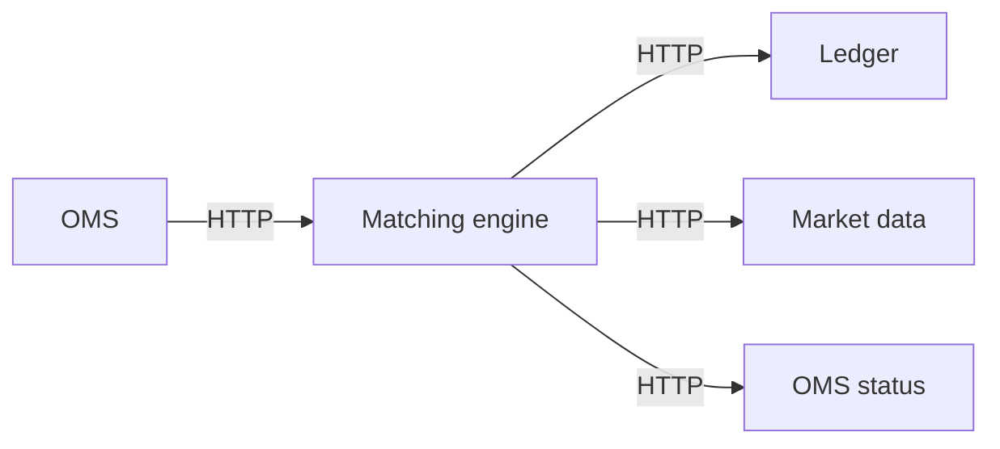
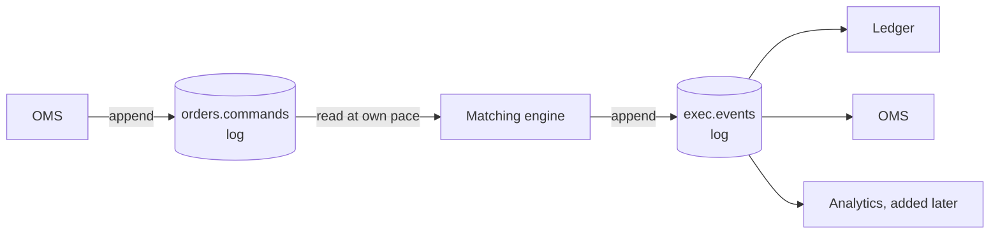
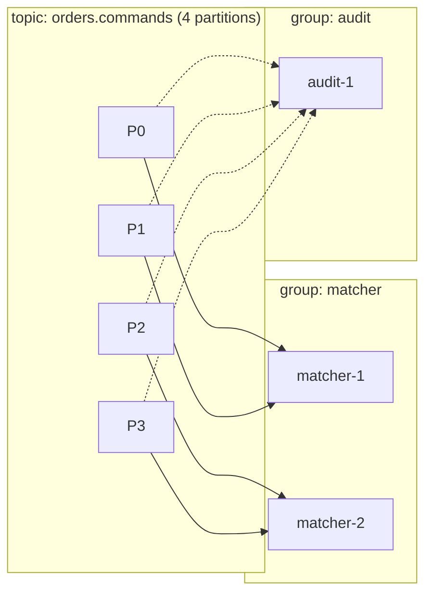

# Kafka from Zero

## 1. The problem Kafka solves

Imagine the order service calls the matching engine directly over HTTP:



Problems:
- If the ledger is down, does the engine stop matching? Retry forever? Drop the trade?
- If the engine crashes, which orders did it receive? Which did it process?
- Adding a new consumer (say, analytics) means changing the engine's code.
- If the engine restarts, it has no history to rebuild its order book from.

**Kafka puts a durable, replayable log in the middle:**



- Producers and consumers are **decoupled in time**: the ledger can be down for 10 minutes and catch up afterwards.
- The log is **durable and replicated**: once Kafka acknowledges a write, it survives broker crashes.
- The log is **replayable**: the engine can rebuild its state by re-reading from any point.
- Consumers are **independent**: each one tracks its own position.

## 2. Mental model: a log, not a queue

A traditional queue (RabbitMQ, SQS) **deletes** a message once it's consumed. Kafka **keeps** it, for a retention period such as 7 days, and each consumer remembers **how far it has read**.

```
Partition 0 of topic "orders.commands"

offset:   0     1     2     3     4     5     6   ← new writes go here
        [ m0 ][ m1 ][ m2 ][ m3 ][ m4 ][ m5 ][   ]
                       ▲                 ▲
          ledger consumer at 2     engine consumer at 5
```

Reading is cheap and non-destructive. Two consumers can read the same data at different speeds. Rewinding means changing a number.

## 3. Core concepts

| Concept | What it is | Why it matters to us |
|---|---|---|
| **Broker** | A Kafka server. A cluster has several (we run 3) | Losing one shouldn't lose data |
| **Topic** | A named log, e.g. `orders.commands` | One per kind of event |
| **Partition** | A topic is split into N ordered logs. **Ordering is only guaranteed within a partition** | We partition by symbol so all orders for INFY stay in order |
| **Offset** | Position of a message in a partition | The consumer's bookmark |
| **Key** | Optional message key. `hash(key) % partitions` decides the partition | Key = symbol keeps each symbol's order |
| **Replication factor** | Each partition is copied to N brokers (we use 3) | Durability |
| **Leader / follower** | One replica per partition is the leader (takes all reads and writes); followers copy it | Leader election on failure |
| **ISR (in-sync replicas)** | Followers that are fully caught up | Determines what "committed" means |
| **Producer** | Client that appends messages | OMS, matching engine |
| **Consumer** | Client that reads messages | Engine, ledger, market data… |
| **Consumer group** | Consumers sharing a group ID split the partitions between them; each partition goes to exactly one member | How we scale consumers horizontally |
| **Committed offset** | The offset a group has recorded as "processed up to here" | Where you resume after a restart |
| **Retention** | How long or how much data is kept (time or size) | Replay window for recovery |
| **Log compaction** | Alternative retention: keep only the latest message per key | Useful for "latest state" topics |
| **KRaft** | Kafka's built-in consensus (replaced ZooKeeper) | One fewer system to run |

### Partitions and consumer groups



- Within a group, **each partition has exactly one consumer**, so the maximum parallelism equals the number of partitions.
- Different groups each get **all** the data independently.
- When a consumer joins or leaves, partitions are **rebalanced**. During a rebalance, processing pauses. This is a classic source of latency spikes and duplicates.

## 4. Durability knobs (the important part)

### Producer `acks`

| Setting | Meaning | Risk |
|---|---|---|
| `acks=0` | Fire and forget | Lose data silently |
| `acks=1` | Leader wrote it | Leader dies before followers copy it → data lost |
| `acks=all` | All in-sync replicas wrote it | Slowest, safest. **We use this for orders and trades** |

### `min.insync.replicas`

With `replication.factor=3`, `min.insync.replicas=2` and `acks=all`, a write succeeds only if at least 2 replicas have it. You can lose 1 broker with no data loss and no downtime. If 2 are down, writes are **refused** rather than accepted unsafely. That is the right trade for financial data.

### Idempotent producer

Network blip: the producer sends a message, the ack is lost, the producer retries, and now there are two copies. `enable.idempotence=true` gives each producer an ID and per-partition sequence numbers, so the broker drops duplicates. **Always on for us.**

### Transactions (exactly-once processing)

The matching engine reads an order (offset 42), produces a trade, and must record "I processed offset 42". If it crashes in between, it either re-processes (duplicate trade) or skips (lost order).

Kafka transactions make **"write output messages + commit input offset"** atomic: either all of it happens or none of it does. Consumers using `isolation.level=read_committed` never see output from aborted transactions. See [ADR-0006](../adr/0006-exactly-once-processing.md).

## 5. Delivery semantics in plain words

| Semantics | How you get it | Consequence |
|---|---|---|
| At-most-once | Commit offset **before** processing | Crash = message lost |
| At-least-once | Commit offset **after** processing | Crash = message processed twice |
| Exactly-once (effectively) | Transactions, **or** at-least-once + idempotent consumer | No loss, no visible duplicates |

**Rule of thumb for this project:** assume at-least-once everywhere, and make every consumer idempotent (dedupe by event ID or sequence). Use transactions where the cost of a duplicate is high (the engine).

## 6. Performance knobs

| Knob | Effect | Trade-off |
|---|---|---|
| `linger.ms` | Producer waits up to N ms to batch messages | ↑ throughput, ↑ latency |
| `batch.size` | Max batch bytes per partition | Bigger = better compression and throughput |
| `compression.type` | lz4 / zstd / snappy | CPU vs network/disk |
| `fetch.min.bytes`, `fetch.max.wait.ms` | Consumer waits for enough data | Throughput vs latency |
| Partition count | Parallelism ceiling | More partitions = more files, slower failover and rebalances |
| `max.poll.records` | Records per poll | Large values risk exceeding `max.poll.interval.ms` → kicked from the group |

We'll measure these trade-offs in Phase 2 and record them in `perf-log/`.

## 7. Things that bite people

1. **Ordering across partitions doesn't exist.** If INFY orders land in two partitions, a cancel can overtake the order it cancels.
2. **Hot partitions.** If one symbol gets 80% of the traffic, its partition (and the one consumer reading it) becomes the bottleneck. More partitions won't help.
3. **Rebalance storms.** Slow processing → exceeds `max.poll.interval.ms` → kicked out → rebalance → duplicates → slower still.
4. **Unclean leader election** (`unclean.leader.election.enable=true`) trades data loss for availability. Keep it **off**.
5. **Consumer lag** is the key health metric: how far behind the head of the log a consumer is.
6. **Large messages** hurt throughput. Keep events small and use binary encoding (protobuf).
7. **Kafka is not low-latency the way a function call is.** With `acks=all` and replication, expect around 2–10 ms. Fine for us, but it's why real exchanges use custom in-memory replication.

## 8. Where Kafka sits in our system

| Topic | Key | Producer → Consumers | Notes |
|---|---|---|---|
| `orders.commands` | symbol | OMS → matcher | NewOrder / CancelOrder. **System of record** for order intent |
| `exec.events` | symbol | matcher → OMS, ledger, risk | Accepted / Rejected / Fill / Cancelled (private, per order) |
| `md.events` | symbol | matcher → marketdata, candles | Book deltas + public trades |
| `account.events` | account_id | ledger → OMS/risk cache | Cash and holdings changes (deposits, settlements) |

Full detail in [architecture.md](../architecture.md#5-kafka-topics-and-events).

## 9. Hands-on labs (Phase 0)

Do these with `docker compose` (3-broker KRaft cluster) and the `kcat` CLI or a small Java program using the official `kafka-clients` library. **Write the labs with the raw client first, not Spring Kafka**, so you see what Spring will later do for you.

1. **Hello log.** Create a topic with 3 partitions, produce 100 keyed messages, consume them. Observe that order holds per key, not globally.
2. **Consumer groups.** Start 1, then 2, then 4 consumers in one group on a 3-partition topic. Who gets what? Why is the 4th idle?
3. **Replay.** Reset the group's offsets to the beginning and consume everything again.
4. **Kill a broker.** Produce continuously with `acks=all`, `min.insync.replicas=2`, and `docker kill` one broker. Any errors? Any loss? Now kill a second one. What happens to writes?
5. **Duplicates.** Disable idempotence, inject network latency with Toxiproxy, and count duplicates. Re-enable it and count again.
6. **Latency vs throughput.** Measure p50/p99 produce latency for `linger.ms` = 0, 5, 20. Plot it.
7. **Lag.** Make a consumer artificially slow and watch its lag grow in Grafana.

## 10. Further reading

- *Kafka: The Definitive Guide* (2nd ed.), chapters 1–7
- Jay Kreps, ["The Log: What every software engineer should know about real-time data's unifying abstraction"](https://engineering.linkedin.com/distributed-systems/log-what-every-software-engineer-should-know-about-real-time-datas-unifying)
- Confluent docs: "Exactly-once semantics" and "Producer configs"
- *Designing Data-Intensive Applications* (Kleppmann), chapter 11
