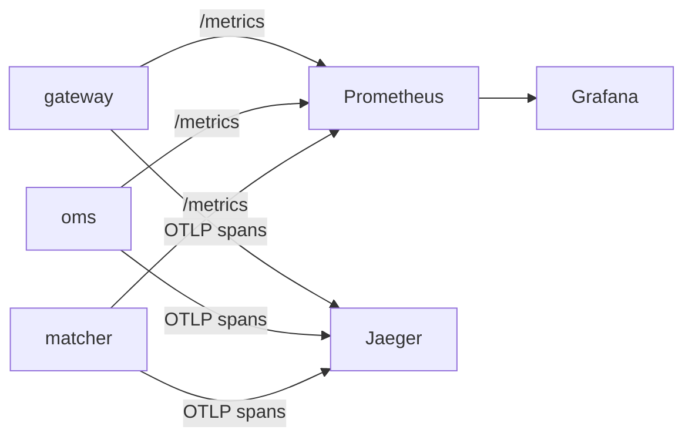

# Observability & Measuring Performance Honestly

Non-functional requirements only mean something if you can **measure** them. This primer covers how to see what the system is doing and how to measure latency without fooling yourself.

## 1. The three signals

| Signal | Answers | Tool |
|---|---|---|
| **Metrics** | "How many, how fast, how full?", aggregated over time | Prometheus (collects), Grafana (dashboards) |
| **Logs** | "What exactly happened in this one case?" | Structured JSON logs (SLF4J + Logback JSON encoder), Loki optional |
| **Traces** | "Where did this one request spend its time across services?" | OpenTelemetry → Jaeger |



## 2. Metrics that matter

**The RED method** (for every service): **R**ate (req/s), **E**rrors (failed/s), **D**uration (latency histogram).

**The USE method** (for every resource): **U**tilization, **S**aturation (queue length), **E**rrors.

System-specific metrics:
- Kafka **consumer lag** per group/partition
- Matching engine: orders/s, book depth, match latency histogram
- Redis: ops/s, latency, memory, evicted keys, connected clients
- Postgres: transactions/s, lock waits, connection count
- JVM: heap, threads (platform + virtual), **GC pause** times, JIT compilation (Micrometer exposes these automatically)

## 3. Latency: why averages lie

Say 99 requests take 1 ms and 1 takes 1,000 ms. The average is ~11 ms, which describes no request at all. Percentiles tell the truth:

- **p50** (median): the typical experience
- **p99**: 1 in 100 is slower than this. With 100 requests per page load, most users hit it
- **p99.9 / max**: tail latency, where GC pauses, rebalances and lock contention show up

We'll set **SLOs on p99** (and track p99.9).

### Histograms

You **cannot average percentiles** across instances. Record **histograms** (bucketed counts) and compute percentiles from the merged histogram:
- Prometheus histograms (choose bucket boundaries carefully, or use native histograms)
- **HdrHistogram** in load generators and benchmarks: high dynamic range and accurate tails

## 4. Coordinated omission: the classic benchmarking mistake

A naive load generator does this:

```
loop:
    start = now()
    send request, wait for response
    record(now() - start)
```

If the server freezes for 1 second, this client sends **one** request in that second and records one slow sample. A real system with real users arriving at 1,000 req/s would have had **1,000** requests stuck, each waiting up to a second. The naive tester **hides** the stall.

**Fix:** open-loop load generation. Schedule requests at fixed intended times (e.g. every 1 ms) whether or not earlier ones have finished, and measure latency **from the intended send time**. Our load generator must do this. (See Gil Tene, "How NOT to Measure Latency".)

## 5. Profiling

When something is slow, **measure before guessing**:

| Tool | Use |
|---|---|
| JMH | Microbenchmarks with proper warm-up and statistics; `-prof gc` shows allocations per op |
| async-profiler | CPU, allocation and lock profiles → flamegraphs (low overhead, no safepoint bias) |
| JFR + JDK Mission Control | Always-on recording: GC, allocations, locks, thread states, I/O |
| GC logs (`-Xlog:gc*`) | Pause times and causes |
| `perf` / eBPF | System-level: syscalls, cache misses |

Every optimization in this project gets a `perf-log/` entry with before/after flamegraphs ([engineering-practices.md](../engineering-practices.md)).

## 6. Tracing one order

Each order carries a trace context (W3C `traceparent`) from the gateway → OMS → **Kafka headers** → matcher → exec events → OMS → client. In Jaeger, you'll see one timeline showing exactly where the 12 ms went.

## 7. Dashboards we'll build

1. **Golden signals**: per-service rate, errors, p50/p99/p99.9
2. **Order pipeline**: end-to-end latency breakdown (gateway → Kafka → engine → back)
3. **Kafka**: lag, produce latency, ISR shrinks, under-replicated partitions
4. **Market data**: subscribers, tick-to-client latency, conflation rate, slow-consumer disconnects
5. **Correctness**: reconciliation results, ledger imbalance (must be flat at 0), double-fill detector (must be 0)

## 8. Further reading

- Gil Tene, "How NOT to Measure Latency" (talk)
- Brendan Gregg, *Systems Performance*; his flamegraph articles
- Google SRE book, chapters 4 and 6 (SLOs, monitoring)
- Prometheus docs: "Histograms and summaries"
