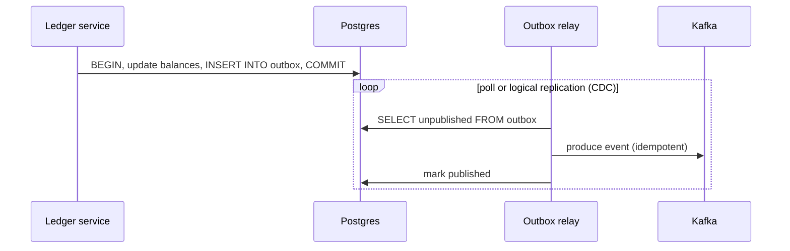

# PostgreSQL for This Project

You've probably used SQL before. This primer focuses on what matters for **financial correctness under load**.

## 1. Why Postgres here

Kafka gives us a durable log, and Redis gives us fast but lossy state. Neither is good at:
- **Invariants across many rows** ("debits = credits", "balance never negative")
- **Ad-hoc queries** ("all trades for account 42 last week")
- **Strong guarantees** for long-lived money records

Postgres holds the **financial source of truth**: the ledger, accounts, and order and trade history (as projections).

## 2. ACID in one table

| Letter | Meaning | Example for us |
|---|---|---|
| **A**tomicity | All statements in a transaction commit, or none do | Both legs of a double-entry posting are written together |
| **C**onsistency | Constraints always hold | `CHECK (balance >= 0)`, `UNIQUE (trade_id)` |
| **I**solation | Concurrent transactions don't see each other's half-done work | Two settlements for the same account don't corrupt its balance |
| **D**urability | Committed = on disk (WAL fsync) | Survives a crash |

## 3. How Postgres works underneath (just enough)

- **WAL (Write-Ahead Log):** every change is appended to a log and fsynced **before** the commit returns. Data pages are written lazily. (It's the same idea as Kafka's log.)
- **MVCC:** an update writes a *new version* of the row instead of overwriting it. Readers see a consistent snapshot without blocking writers. Old versions are cleaned up by **VACUUM**. A neglected VACUUM causes bloat.
- **Process per connection:** each connection is an OS process (~10 MB). 1,000 connections will hurt. Use a **pooler (PgBouncer)**.

## 4. Isolation levels and anomalies

| Level | Prevents | Still allows |
|---|---|---|
| Read Committed (default) | Dirty reads | Lost updates (if you read-then-write in app code), non-repeatable reads |
| Repeatable Read | + non-repeatable reads | Write skew |
| Serializable | Everything; behaves as if transactions ran one at a time | Transactions may **fail with serialization errors** and must be retried |

**Lost update example:** two transactions both `SELECT balance` (100), both write `balance = 100 - 30`. The final balance is 70, not 40.

Fixes:
- Do the arithmetic in SQL: `UPDATE accounts SET balance = balance - 30 WHERE id = 42` (row lock, safe).
- `SELECT … FOR UPDATE` to lock the row before reading.
- Serializable isolation + retry.

## 5. Idempotency with constraints

The ledger consumes trades from Kafka **at least once**. Make duplicates harmless with a unique constraint:

```sql
BEGIN;
INSERT INTO processed_events (event_id) VALUES ($1)   -- UNIQUE / PK
  ON CONFLICT DO NOTHING;
-- if 0 rows inserted → duplicate → ROLLBACK and skip
INSERT INTO postings ...;                              -- the actual work
UPDATE balances ...;
COMMIT;
```

The dedupe check and the work are in **the same transaction**, so they succeed or fail together.

## 6. The outbox pattern

Problem: the ledger updates a balance **and** must publish `account.events` to Kafka. If it writes to the DB and then crashes before publishing, Redis never learns about the change. If it publishes first and the DB write fails, Redis has a balance the DB doesn't.



The event is written atomically with the change, then delivered at least once. Downstream consumers dedupe.

## 7. Performance knobs we'll explore

| Topic | Notes |
|---|---|
| Batching | Insert/settle 500 trades in one transaction vs 500 transactions: measure the difference |
| `COPY` | Fastest bulk ingest |
| Indexes | Every index speeds reads and slows writes. Use `EXPLAIN ANALYZE` |
| Partitioning | Partition the trades table by day; dropping old partitions is instant |
| `synchronous_commit = off` | Faster commits, may lose the last ~ms on crash. **Not for the ledger** |
| Connection pooling | PgBouncer in transaction mode |
| Hot rows | One account receiving a flood of updates means lock contention on a single row. Same problem as a hot Kafka partition |
| Replication | Streaming replica for reads and failover |

## 8. Where Postgres sits in our system

| Table | Purpose |
|---|---|
| `accounts` | Account metadata |
| `ledger_entries` | Immutable double-entry postings (append-only) |
| `balances` | Current balance per (account, asset): derived from entries, kept for fast reads |
| `orders`, `trades` | Projections of Kafka events for history and queries |
| `processed_events` | Idempotency for consumers |
| `outbox` | Events waiting to be published |

## 9. Labs (Phase 0 / Phase 5)

1. Reproduce a lost update with two concurrent Java threads (plain JDBC), then fix it three ways.
2. Benchmark 10k single-row transactions vs batched transactions of 100 and 1,000.
3. Use `EXPLAIN ANALYZE` on a trade-history query before and after adding an index.
4. Open 500 connections directly, then through PgBouncer, and compare.

## 10. Further reading

- *Designing Data-Intensive Applications*, chapters 3, 5 and 7 (storage, replication, transactions)
- Postgres docs: "Concurrency Control" (MVCC & isolation)
- *The Art of PostgreSQL* (Dimitri Fontaine)
