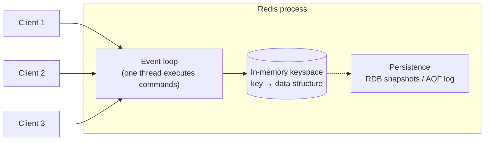
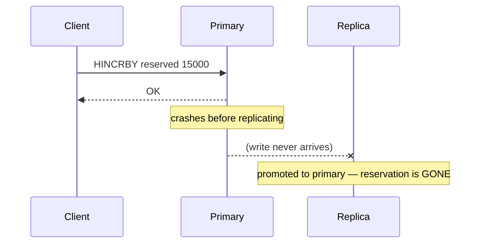

# Redis from Zero

## 1. The problem Redis solves

Some data is read and written **extremely often** and needs answers in **well under a millisecond**:

- "Does user 42 have ₹15,010 available right now?" (on every order)
- "Has user 42 sent more than 50 orders in the last second?" (on every request)
- "What's the current top of book for INFY?" (thousands of times per second)

A relational database can do this, but each query costs about 1–5 ms, plus connection overhead, locks and disk. Redis keeps everything **in memory** and answers in about **50–200 µs** over the network.

## 2. Mental model

Redis is a **single-threaded server holding a big in-memory dictionary**, where the values are rich data structures (not just strings).



**Single-threaded command execution** is the key idea:
- Each command runs **alone, start to finish**. No two commands interleave, so every individual command is atomic.
- That's why it's fast: no locks.
- It's also why **one slow command blocks everyone** (`KEYS *` on 10M keys stalls the whole server).

(Modern Redis uses extra threads for network I/O, but commands still execute one at a time.)

## 3. Data structures

| Type | Think of it as | Example in our system |
|---|---|---|
| **String** | key → bytes/number | `md:INFY:snapshot` → serialized book; `INCR` counters |
| **Hash** | key → small map | `acct:42` → `{cash: 2000000, reserved: 1501000}` |
| **List** | linked list / deque | Recent trades per symbol (`LPUSH` + `LTRIM`) |
| **Set** | unordered unique set | Symbols a WS gateway is subscribed to |
| **Sorted set (ZSET)** | set with a score, kept sorted (skip list) | Sliding-window rate limiter (score = timestamp); leaderboards |
| **Stream** | append-only log with consumer groups (a mini Kafka) | Alternative fan-out channel ([ADR-0007](../adr/0007-market-data-fanout.md)) |
| **Pub/Sub** | fire-and-forget broadcast channel; nothing is stored | Live market data to WS gateways |

**TTL (expiry):** any key can expire: `SET idem:c-8f2a "…" EX 86400`. We use this for idempotency keys.

## 4. Atomicity: the part people get wrong

Every single command is atomic. **A sequence of commands is not.**

```
# Two orders for the same user, run concurrently — BROKEN
avail = HGET acct:42 cash - HGET acct:42 reserved   # both read 20,000
if avail >= 15000: HINCRBY acct:42 reserved 15000    # both succeed → overspent
```

Three ways to fix it:

| Mechanism | How | When |
|---|---|---|
| **Lua script** (`EVAL`/`FCALL`) | The whole script runs atomically on the server | **Our choice for risk checks**: check-and-reserve in one round trip |
| `MULTI`/`EXEC` + `WATCH` | Optimistic transaction; aborts if a watched key changed | Fine at low contention; retries pile up when contention is high |
| Single smart command | e.g. `INCRBY`, `SET NX` | Simple cases (rate counters, "claim this key once") |

```lua
-- reserve.lua  KEYS[1]=acct:42  ARGV[1]=amount
local cash = tonumber(redis.call('HGET', KEYS[1], 'cash') or '0')
local res  = tonumber(redis.call('HGET', KEYS[1], 'reserved') or '0')
if cash - res < tonumber(ARGV[1]) then return 0 end
redis.call('HINCRBY', KEYS[1], 'reserved', ARGV[1])
return 1
```

Keep Lua scripts **short**. While one runs, nothing else runs.

## 5. Persistence: Redis is not a database (by default)

| Mode | How | Data you can lose on crash |
|---|---|---|
| None | Pure cache | Everything |
| **RDB** | Periodic full snapshot (fork + write) | Everything since the last snapshot (minutes) |
| **AOF** `appendfsync everysec` | Log every write, fsync each second | ~1 second |
| AOF `always` | fsync every write | ~nothing, but much slower |

### Replication is asynchronous



A write acknowledged by the primary can be **lost on failover**. `WAIT` can reduce this but doesn't eliminate it. **Design consequence:** Redis holds *derived, rebuildable* state for us. Postgres and Kafka are the sources of truth, and we can rebuild the Redis risk state from them ([ADR-0005](../adr/0005-pre-trade-risk-in-redis.md)).

## 6. Scaling and high availability

| Setup | What it gives you |
|---|---|
| Single node | Simple; a single point of failure |
| Primary + replicas + **Sentinel** | Automatic failover; reads can go to replicas |
| **Redis Cluster** | Data sharded across 16,384 hash slots on many primaries |

In Cluster mode, a multi-key command or Lua script only works if **all its keys are in the same slot**. Use **hash tags**: `{acct:42}:cash` and `{acct:42}:reserved` hash only `acct:42`, so they land together.

## 7. Performance

| Technique | Why |
|---|---|
| **Pipelining** | Send many commands without waiting for each reply. Removes round-trip time (RTT) cost; often 5–10× throughput |
| Connection pooling | Avoid connect/handshake per request |
| Avoid big keys | A 1M-element hash makes `DEL`/`HGETALL` block the server |
| Avoid `KEYS`, use `SCAN` | `KEYS` is O(N) and blocking |
| Choose `maxmemory-policy` deliberately | `noeviction` for state we need; `allkeys-lru` for pure caches |
| Watch the slowlog and latency monitor | Finds the command that's blocking everything |

## 8. Pub/Sub vs Streams

| | Pub/Sub | Streams |
|---|---|---|
| Storage | None. A subscriber that's offline misses messages | Stored, replayable, trimmed by length |
| Delivery | Push to whoever is subscribed right now | Consumers pull; consumer groups; acks |
| Latency | Lowest | Low |
| Slow subscriber | Redis buffers output until `client-output-buffer-limit`, then **disconnects it** | Subscriber just falls behind |

For live prices, losing an update is acceptable *if* clients can detect gaps (sequence numbers) and re-sync from a snapshot. That's our design.

## 9. Where Redis sits in our system

| Use | Keys | Structure |
|---|---|---|
| Rate limiting | `rl:{user}` | Sorted set (sliding window) or token bucket in Lua |
| Idempotency | `idem:{user}:{client_order_id}` | String with TTL |
| Pre-trade risk | `{acct:ID}` | Hash: cash, reserved, holdings per symbol, reserved qty |
| Market data snapshots | `md:{SYM}:book` | String (binary-encoded L2 + seq) |
| Market data fan-out | channel `md.{SYM}` | Pub/Sub |
| Recent candles | `candle:{SYM}:1s` | List / sorted set |

## 10. Hands-on labs (Phase 0)

1. **CLI tour.** `redis-cli`: try strings, hashes, sorted sets, `EXPIRE`, `TTL`, `MONITOR`.
2. **The race.** Write a Java program with 100 threads (an `ExecutorService`) reserving money with GET-then-SET. Watch it overspend. Fix it with Lua. Prove the fix with a test.
3. **Rate limiter.** Build fixed-window, sliding-window (ZSET) and token-bucket limiters. Compare accuracy at window boundaries and the ops each one costs.
4. **Pipelining.** Benchmark 100k `SET`s with and without pipelining. Explain the difference using RTT.
5. **Pub/Sub slow consumer.** Publish 50k msg/s and subscribe with a client that sleeps. Watch Redis disconnect it (`client-output-buffer-limit`).
6. **Lose data on purpose.** Primary + replica + Sentinel; write in a loop; kill the primary. Count lost writes.
7. **`redis-benchmark`.** Learn it now. You'll point it at your own Redis clone in Phase 7.

## 11. Further reading

- [redis.io/docs](https://redis.io/docs/): data types, persistence, replication, Lua scripting
- *Redis in Action* (Carlson), older but still a good tour of patterns
- Antirez's blog posts on Redis design
- Martin Kleppmann, ["How to do distributed locking"](https://martin.kleppmann.com/2016/02/08/how-to-do-distributed-locking.html). Read it before you ever use Redis as a lock.
