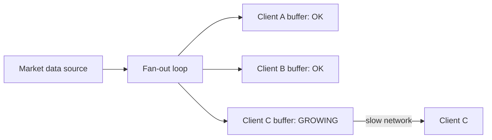
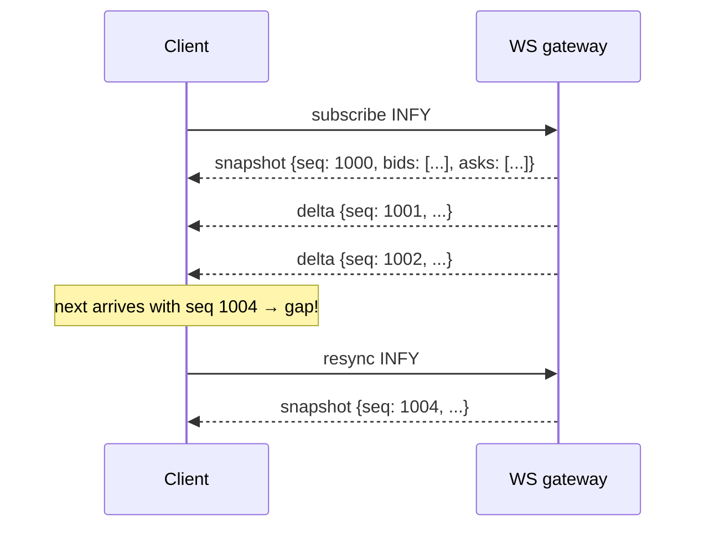

# WebSockets & Real-Time Fan-out

## 1. The problem

A trader's screen should update **as soon as** the price changes. The options:

| Approach | How | Problem |
|---|---|---|
| Polling | Client asks "anything new?" every second | Stale by up to 1 s; wasted requests when nothing changed |
| Long polling | Server holds the request until there's data | A new request per message; awkward |
| Server-Sent Events | One-way server→client stream over HTTP | Fine, but one direction only and text-based |
| **WebSocket** | A persistent, bidirectional connection; either side sends frames anytime | Long-lived connections are stateful and harder to scale. **Our choice** |

A WebSocket starts as an HTTP request with `Upgrade: websocket`. After that, the TCP connection carries lightweight binary or text **frames** in both directions.

## 2. The hard parts

### 2.1 Many connections

Each connection holds memory (buffers, thread stacks) and a file descriptor. 10k connections is fine on one JVM if you choose the threading model deliberately: **one platform thread per connection does not scale** (~1 MB stack each), but **virtual threads** (Java 21+) or an **event-loop model** (Netty / Spring WebFlux) do. The things to know:
- OS limits: `ulimit -n`, ephemeral port ranges on the load-generator side
- Per-connection memory: virtual thread (~1–2 KB when parked) or Netty channel state, plus read/write buffers
- Heartbeats (ping/pong) to detect dead connections

### 2.2 Slow consumers (the most important concept here)

The server produces 5,000 updates/s for INFY. One client is on a train with a bad connection and can read only 100/s. What happens?

| Strategy | What happens | Trade-off |
|---|---|---|
| Unbounded buffer | Memory grows until the process dies, killing **everyone** | Never do this |
| Block the fan-out loop | One slow client slows everyone down | Never do this |
| Drop messages | Bounded buffer; drop when full | Client sees gaps and must re-sync |
| **Conflate** | Keep only the **latest** state per symbol per client; send it when the client is ready | Client gets fewer but always current updates. **Best for prices** |
| Disconnect | Kick clients that stay too far behind | Protects the server |

We'll use **conflation + disconnect after a threshold**, and measure all of them in Phase 4.

### 2.3 Snapshot + delta with sequence numbers

Sequence numbers let lossy transports (Redis Pub/Sub, dropped frames) stay **correct**: the client always knows when it's out of date.

### 2.4 Scaling horizontally

WS gateways are **stateless apart from their connections**. Each gateway subscribes to Redis channels for the symbols its clients want. Add more gateways behind a load balancer to handle more clients. See [architecture](../architecture.md#43-market-data-fan-out).

## 3. Metrics to watch

- Connected clients per gateway
- Per-client send-queue depth (p99) and how often conflation happens
- **Tick-to-client latency**: engine event timestamp → client receive time
- Disconnects by reason (slow consumer, heartbeat timeout, client close)

## 4. Labs (Phase 4)

1. Build an echo WebSocket server with Spring WebSocket (on virtual threads) and another with Spring WebFlux (Netty event loop). Connect 10k clients from the Java load generator. Compare memory per connection and p99.
2. Broadcast 1k msg/s to 10k clients. Measure latency distribution and CPU.
3. Add one deliberately slow client and show it doesn't affect the others (or that it does, before you fix it).
4. Compare JSON vs binary (protobuf) frames for CPU and bandwidth.

## 5. Further reading

- RFC 6455 (skim sections 1 and 5)
- Spring docs: "WebSockets" (Servlet stack) and "WebSockets" (Reactive stack)
- JEP 444 (Virtual Threads); Netty in Action (chapters on channels and event loops)
- "The C10K problem" (Dan Kegel), for historical context
